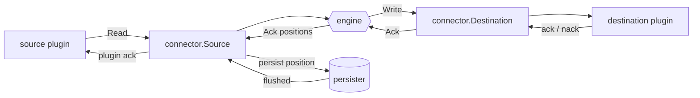
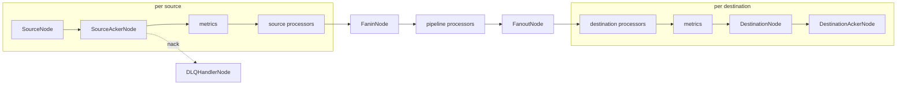
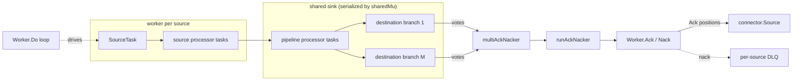

# Life of a record

> Draft. Describes the two pipeline engines as they are on `main` today. It is not a design for the
> single engine; that is proposed in [#2971](https://github.com/ConduitIO/conduit/pull/2971), is not
> decided, and would replace the v2 half of this page if it lands.

A record travels from a source connector's plugin to every destination connector's plugin. Two
engines move it, and they differ in how much they move at once and when they let go of it.

| | v1 (default) | v2 (arch-v2, `--preview.pipeline-arch-v2`) |
| --- | --- | --- |
| Package | `pkg/lifecycle`, `pkg/lifecycle/stream` | `pkg/lifecycle-poc`, `pkg/lifecycle-poc/funnel` |
| Unit of work | one message per record, one goroutine per node, channels between nodes | one batch per pass, one worker per source, tasks called in sequence |
| Reads while a batch is in flight | yes, until the plugin boundary pushes back | no: the next read waits for every ack of the previous batch |
| Ack to the source | per record, in order, through a semaphore | per position, released as an in-order prefix |
| Destination write | one record per `Write` | one batch per `Write` |

Everything the engines share sits below them and is described once, in the next section.

## What is shared: the connector wrapper

Both engines talk to `connector.Source` and `connector.Destination` (`pkg/connector`), not to the
plugin. The wrapper owns the two rules that make acknowledgment safe:

1. `Source.Ack` records the new position and hands it to the persister (`pkg/connector/persister.go`,
   debounced at 1 s or 10,000 positions). The plugin is told about the ack **only after** that write has
   flushed durably, so a plugin that frees upstream data on ack (a Postgres slot advancing its LSN) can
   never get ahead of Conduit's own checkpoint. See
   [`20260723-source-ack-persist-ordering-fix.md`](../design-documents/20260723-source-ack-persist-ordering-fix.md).
   This is invariant 1 at the source end.
2. `Destination.Write` sends records and `Destination.Ack` returns the plugin's acknowledgments, in write
   order. A destination ack is the moment a record counts as durably handled downstream.

## v1: a graph of nodes, one message per record

`Service.buildNodes` (`pkg/lifecycle/service.go`) builds one graph per pipeline out of
`pkg/lifecycle/stream` nodes. Nodes are goroutines connected by channels; each record is a
`stream.Message` that carries its own ack and nack handlers, so the ack travels backwards through the
same objects that carried the record forwards.

Forward path:

1. `SourceNode` calls `Source.Read`, wraps each returned record in a `Message` and sends it downstream.
   It keeps reading while the channels accept messages; nothing in the engine limits how many are open
   at once (see [guarantees](guarantees.md#memory-bound)).
2. `SourceAckerNode` registers the ack and nack handlers on the message and an entry in an ordering
   semaphore, then forwards it.
3. Processor nodes transform, filter or split. `workers > 1` wraps a processor in a `ParallelNode` that
   reassembles results in dispatch order.
4. `FaninNode` merges the sources; `FanoutNode` sends a copy per destination and counts the votes.
5. `DestinationNode` writes **one record per `Write`** and passes the message to
   `DestinationAckerNode`, which runs `Destination.Ack` on its own goroutine and matches each ack to the
   next message in its queue.

Backward path:

- A destination ack acks the message. `FanoutNode` waits for every destination; the first nack wins.
- When the message is acked, the `SourceAckerNode` handler takes its turn in the semaphore (so acks reach
  the source in read order), calls `Source.Ack`, and reports the ack to the DLQ window.
- When it is nacked, the handler asks the `DLQHandlerNode`. If the nack window still has room, the record is
  written to the DLQ destination and then acked to the source. If not, the handler returns an error and
  the pipeline stops; a non-fatal error sends the run to recovery.

Stop: `SourceNode.Stop` asks the plugin to stop (`Source.Stop` returns the last position it produced) and
injects a control message. The node returns after emitting that position, the channels close
downstream-wards, and `SourceNode` waits for its open-message tracker, i.e. for every in-flight message to
be acked or nacked end to end, before it calls `Source.Teardown`.

## v2: one worker per source, one batch at a time

`Service.buildRunnablePipeline` (`pkg/lifecycle-poc/service.go`) builds one `funnel.Worker` per source and
one shared `funnel.Sink` for everything after the sources. The worker is a loop over tasks; there are no
goroutines or channels between them.

One pass of `Worker.Do`:

1. `SourceTask.Do` calls `Source.Read` and gets a batch: the plugin's `sdk.batch.size`, which defaults to 0
   and so reads batches of one (effectively 1).
2. Source processor tasks run on the batch. A processor may filter records or split one into several.
3. The pass enters the shared sink under `sharedMu`, which is what serializes N sources onto one set of
   destinations. Pipeline processors run, then the batch fans out to each destination branch.
4. `DestinationTask.Do` calls `Destination.Write` with the whole batch and then `Destination.Ack` until
   every position has an ack. **The pass does not return until then.** This is the stop-and-wait that the
   single-engine proposal (#2971) aims to replace, and why a destination that holds acks until it has a full
   batch stalls
   v2 ([#2990](https://github.com/ConduitIO/conduit/issues/2990)).
5. Votes go to `multiAckNacker`, which tracks ack/nack per original source position, not per batch
   (ADR [`20260731-archv2-fanout-ack-model`](../architecture-decision-records/20260731-archv2-fanout-ack-model.md)).
   A position is acked when every branch acked it; the first nack wins. It releases the leading run of
   terminal positions to the parent in source order.
6. `runAckNacker` holds back the position of a record that a processor split until every piece is terminal
   (invariant 1 for split records).
7. `Worker.Ack` calls `Source.Ack` with the released positions. `Worker.Nack` writes the nacked records that
   the DLQ window accepts to this source's DLQ and acks those to the source. If the window cannot take all of
   them it returns an error, and the rest stay unacked and are redelivered.

Only after step 7 does the loop read again. So at any moment a v2 worker has at most one batch in flight,
and the stream of acks to the source is naturally ordered.

Stop: `Worker.Stop` waits for the in-flight batch (it takes the processing lock the pass holds), sets the
stop flag, then tears down the source, which is what unblocks a `Read` that is parked. `Do` returns nil on
the next check. The shared sink is closed once, after every worker has exited
(`Sink.Close`, invariant 1 and 3), because closing it earlier would tear down a destination a sibling is
still writing to.

## Where the engines differ in behaviour

Differences found while building the test kit ([#3027](https://github.com/ConduitIO/conduit/pull/3027)) and in
the existing parity work. None is a bug on its own; each matters to anyone moving a pipeline between engines.

| Behaviour | v1 | v2 |
| --- | --- | --- |
| Source returns `io.EOF` | pipeline error: `source stream was stopped unexpectedly` | that source ends gracefully; siblings keep running |
| Position on a DLQ record | a message ID | the source position; the original record is also in the payload |
| Destination that acks only when it has a full batch (SDK batching, delay 0, reads smaller than the batch) | works: the next record is written without waiting | no progress, #2979 refuses it at start, #2990 tracks the rest |
| Processor `workers > 1` | honoured, order preserved | ignored |
| Records read ahead of a destination that holds its acks | unbounded in the engine | one batch |
| Poison record with the default DLQ (window 1, threshold 0) | destination-side ack errors loop in `Recovering` | every nack type loops in `Recovering` ([#2997](https://github.com/ConduitIO/conduit/issues/2997)) |

## Where to look next

- [Guarantees](guarantees.md): what each engine promises and which test enforces it.
- `pkg/lifecycle/stream/doc.go` for the v1 message states.
- [`docs/package_structure.md`](../package_structure.md) for the wider package layout.
- [`CONTRIBUTING.md`](../../CONTRIBUTING.md#changing-a-pipeline-engine) before changing either engine.
