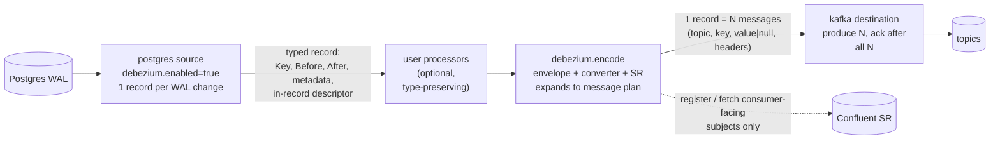

# Debezium-compatible output for Postgres CDC

## Summary

A team that runs Debezium Postgres on Kafka Connect and moves to Conduit should not have to touch a
consumer. This design adds an opt-in Debezium output mode for the Postgres source. The mode
reproduces topic names, key and value structure (the Debezium envelope), headers, Schema Registry
subjects and schemas, tombstones, and the Debezium encodings for decimals, time types, JSON, arrays,
enums, UUIDs and bytea. The default output does not change.

The mode is split across three places, each doing the one thing it has the information to do:

1. **Postgres source** (`debezium.*` settings, connector v0.15.0): decodes WAL text into Debezium-typed
   values and emits **exactly one record per WAL change**, carrying a Connect-typed schema descriptor
   (in-record, never in the consumers' registry), the `source` and `transaction` blocks as metadata, and
   the Debezium topic name. Only the source can do this without losing information (numeric scale,
   unchanged-TOAST markers, replica identity, catalog nullability).
2. **`debezium.encode` builtin processor** (Conduit core): builds the envelope, serializes key and value
   with the Avro (Confluent wire format, Schema Registry) or JSON converter, applies subject naming, and
   expands one record into the **message plan** Debezium would have produced for that WAL change: one
   message for an insert, a delete plus a tombstone, delete + tombstone + create for a primary-key
   change, one message per table for a multi-table truncate. It runs last, so processors placed before it
   still see structured data.
3. **Kafka destination**: writes a record's message plan as one unit (all messages produced with
   per-message results tracked by index, the record acknowledged only when every message succeeded), with
   per-message topic, key, value (null for tombstones), and headers. Prerequisite: the batch `Produce`
   result bug (`conduit-connector-kafka#308`) must be fixed first.

`conduit migrate kafka-connect` reads the Debezium and converter settings from the Kafka Connect config
and sets all three. The reference for "correct" is real Debezium, pinned by version, in a diff harness.
This document does not try to re-document Debezium by hand. Behavior stated here was verified against
Debezium source (main at 0d0a319 and the 2.7 branch at eef5c19) in the Tier 1 review; items marked
**(V)** remain open and the harness decides them. The implementation follows the harness, not this text.

Risk tier: **Tier 1** for the implementation (serialization formats, schema handling, positions
interplay). This document is Tier 3 (docs). DeVaris sign-off and a fresh-context review are required
before any implementation PR opens. An ADR for the placement decision is written after sign-off.

Roadmap item: v0.21: Debezium-compatible output mode (Postgres), issue #3032. MySQL output is v0.22.

## Context

### What exists (inventory)

| Asset | Where | State | Use here |
| --- | --- | --- | --- |
| `unwrap.debezium` processor | `pkg/plugin/processor/builtin/impl/unwrap/debezium.go` | Decodes a Debezium event into an OpenCDC record. Opposite direction. | Reference for field names only. |
| `sdk.record.format: debezium` (`DebeziumConverter`) | `conduit-connector-sdk/record_serializer.go`, `kafkaconnect/debezium.go` | Wraps an OpenCDC record in a Connect-JSON envelope. `source` is the whole OpenCDC metadata map, `ts_ms` is `readAt`, `transaction` is always nil, schema is reflected from values, no tombstones, no Avro, no decimal/time logical types. | **Replace for this purpose, not extend** (see alternative C). Its `kafkaconnect` package (Connect schema model, JSON envelope) is the seed for the Connect model library. |
| Kafka destination key format | `conduit-connector-kafka/destination/franz.go` | Writes `Key.Bytes()`, or a Connect-JSON key when `sdk.record.format` is `debezium`. Value is `Record.Bytes()` through the record format. No headers, no Schema Registry, no null-value messages, batch `Produce` returns results in completion order (`conduit-connector-kafka#308`), topic is a Go template (default `opencdc.collection`). | Topic template covers topic naming. Needs message plans, headers, null keys and index-correct acks. |
| `avro.encode` / `avro.decode` processors | `pkg/plugin/processor/builtin/impl/avro` | Confluent wire format through the engine's `schemaregistry.Registry` (`confluent` type is supported). One fixed subject and version per processor instance; no `latest`, no per-topic subject. | Precedent for registry access in a processor. Subject strategy and `latest` (#1095) are new. |
| Postgres source v0.14.3 (built in) and `main` toward v0.15.0 | `conduit-connector-postgres` | Metadata is `opencdc.collection` (table name only, no schema). Key is one column (`TODO composite keys`). Numeric is a `*big.Rat`. `withAvroSchema` extractor sorts fields alphabetically, maps `json`/`jsonb` to bytes, `uuid` and `date` to Avro logical types, and fails on arrays, enums, interval, time and others. Unconstrained `numeric` produces a garbage scale. `Begin` keeps only the final LSN; xid and commit time are dropped. Unchanged TOAST columns are omitted from the payload. Truncate is not handled (see Finding 1). Position carries `TxCommitLSN` and per-record sequence. Heartbeat writer was cut; slot advance is gated. | Source of truth for what must change. |
| Postgres DBZ-3 design docs | postgres repo `docs/design-documents/` | Schema drift policy (`halt` default, `evolve`), snapshot handoff, TOAST finding, tx-boundary records proposed but not built. | This design builds on the drift policy and the change-key ordering. |
| `conduit-kafka-connect-wrapper` | ConduitIO | Runs real Debezium inside a JVM sidecar. Byte-compatible by construction. | Alternative D; also the documented fallback for anything this mode will not cover. |
| `tests/compose-schemaregistry.yaml`, `tests/chaos`, `tests/upgrade` | the Conduit repo | Kafka + Confluent Schema Registry compose, SIGKILL harness, upgrade harness. | Reuse for the diff harness. No Debezium container exists in any harness today. |
| Schema Registry config | `pkg/conduit/config.go` | `--schema-registry.type builtin\|confluent`, basic and bearer auth exist. | Avro compatibility needs `confluent`, pointed at the registry the consumers already use. |

Searched for "debezium" in ConduitIO and conduitio-labs: no other converter or encoder exists.
`conduitio-labs` has no Postgres connector.

### Related work in flight

- `conduit-connector-kafka#308` (batch `Produce` can ack a failed record): prerequisite, owned by another lane.
- postgres#344 (default output drops TRUNCATE): separate fix.
- #3026 (`migrate kafka-connect` design): currently lists `tombstones.on.delete`, `decimal.handling.mode`,
  `time.precision.mode`, `binary.handling.mode`, `hstore.handling.mode`, `interval.handling.mode`,
  `provide.transaction.metadata` and `topic.prefix` as blocking because the mode was v0.22. This design
  changes those rows (see _Migrate integration_).
- #3004 and postgres#341 (Postgres v0.15.0 and Debezium offset import, fresh-slot strategy): same
  connector, same positions. Both lanes edit `source/logrepl/handler.go`.
- #3012 (toolchain and Avro fleet move): removes `hamba/avro` from the connector. The extractor this design
  does not reuse is the one being rewritten there.
- #3010 (migration harness): the diff harness here shares fixtures but is a separate suite.

### Findings from reading the code

1. **Truncate is silently dropped today, in the default output too** (postgres#344). `Handle` has no case
   for `*pglogrepl.TruncateMessage`; the default publication publishes truncates; `subscription.go` counts
   them in the change key. A `TRUNCATE` on the source leaves the destination full of rows, an invariant 3
   violation independent of this design. It is fixed as its own default-output change (representation and
   migration notes); this mode skips truncates by default like Debezium and does not wait for it.
2. **`opencdc.collection` is the bare table name.** Two tables with the same name in different schemas
   collide. Debezium topics include the schema. The debezium mode needs the namespace.
3. **Composite primary keys are not supported** (`buildRecordKey` takes one column). Debezium keys carry
   every key column.
4. **Value decoding goes through pgx values** (`pgtype`), which loses information the WAL text has:
   numeric scale (`1.10` becomes `11/10`), unconstrained numeric scale, `NaN`, and which timestamp text
   form (infinity, BC) was sent. A Debezium-exact decode must work from the WAL text per type OID.

## Constraints

- Invariants 1 to 4 and 6 apply (CLAUDE.md). In particular: the source emits no more than one record per
  WAL change, because the Postgres flush gate and `(TxCommitLSN, TxSeq)` ordering assume it (invariant 2);
  a record is acked only when every message derived from it is durably produced (invariant 1); and nothing
  is dropped, coerced or truncated silently (invariants 3 and 6).
- The default output, its positions and its metadata do not change (see _Default-output isolation_).
- Byte compatibility is the goal for keys, values, schemas and headers; where bytes cannot match, a
  documented difference with a comparison rule.
- Serialized formats are public contracts: versioned, with an upgrade path and test.
- No new dependency without justification. No performance claim without a committed benchi result.
- The Kafka destination is broker-neutral and database-neutral; Postgres semantics stay out of it.

## Goals

- A consumer written for Debezium Postgres events keeps working with no change: same topics, same keys
  (including partitioning), same envelope, same subjects, same schema evolution behavior, same tombstones.
- Where Conduit cannot match, the difference is listed (see _Intentional differences_), reported by
  `migrate`, and tested. No silent coercion or truncation (invariant 6).
- Cutover is safe: replays after an offset-import cutover are byte-identical to the originals except the
  documented volatile fields, and Schema Registry registration of Conduit's schemas returns the existing
  schema IDs, so existing key bytes (and therefore partitions) do not move.
- The default output and its positions are unchanged.

## Non-goals

- MySQL and other databases (v0.22).
- Debezium `decoderbufs` or `wal2json` semantics. The target is Debezium on `pgoutput`.
- Debezium SMTs and Debezium-specific processors that reshape the envelope or its schema
  (`ExtractNewRecordState`, `ReplaceField`, outbox `EventRouter`): the SMT pack (#2960) and the outbox
  processor own those. `migrate` reports them as blocking when combined with the envelope output.
- Protobuf, JSON Schema and Apicurio converters. Avro (Confluent) and JsonConverter only.
- A configurable Debezium emulation matrix beyond the targets below.
- Changing Schema Registry compatibility settings. Conduit never writes subject config.
- Performance claims. Cost of the mode is measured with a committed benchi config; no number appears
  here.

## Debezium versions targeted

| Tier | Versions | Treatment |
| --- | --- | --- |
| A | 2.7.x and the latest stable 3.x at release time, plus the version-boundary images below | Run in the harness on every change to the mode (default config) and nightly (matrix). Output must match, or differ only by listed differences. |
| B | 1.9.x, 2.0 to 2.6, other 3.x | Config keys are read by `migrate`. Output is assumed equal to the nearest tier A compat level except the differences below. A 1.9.7 smoke case runs nightly. No guarantee; 1.9 only on request. |

`debezium.compat` selects the output shape at the boundaries where Debezium's output changes. The
values and the boundaries (verified in the review against Debezium source; the harness runs one image per
boundary: 2.6.0.Beta1 side, 2.7.x, 3.0.4, 3.0.5, 3.5, plus a 3.3 image for the context headers):

| `debezium.compat` | Applies to | Output change at this boundary |
| --- | --- | --- |
| `pre-2.6` | before 2.6.0.Beta1 | no `ts_us`/`ts_ns` in `source` or the envelope |
| `2.6` | 2.6.0.Beta1 to 3.0.4 | adds `ts_us`, `ts_ns`; Avro `allowed` set for `snapshot` is the old one |
| `3.0.5` | 3.0.5 to before 3.5 | Avro `allowed` set for the `snapshot` enum changes (DBZ-8496) |
| `3.5` | 3.5 and later | `source` gains `origin` and `origin_lsn` (verify the exact release in the harness); `.version(1)` on the source schema as on main |

Other differences between versions that `migrate` must account for:

| Area | 1.9 | 2.x | 3.x |
| --- | --- | --- | --- |
| Topic prefix key | `database.server.name` | `topic.prefix` (required from 2.0) | `topic.prefix` |
| `schema.name.adjustment.mode` default | `avro` | `none` from 2.0.0.CR1 | `none` |
| `skipped.operations` default | not `t` | `t` (truncates skipped) since 2.0.0.Beta2 | `t` |
| `snapshot.mode` values | `exported` exists | `exported` removed **(V)** | `never` deprecated for `no_data` **(V)** |

`migrate` sets `debezium.compat` from the Kafka Connect plugin version when present, otherwise it asks
(blocking, one question) rather than guessing. The default for a hand-written pipeline is the latest
boundary.

Incremental snapshots (signal-table or `snapshot` value `incremental`) are **out of scope** for v0.21. The
`snapshot` field's `incremental` value is never produced, `signal.*` and `incremental.snapshot.*` are
reported unsupported by `migrate` (blocking), and the harness has no incremental case (it asserts the
connector rejects the settings).

## Where the mode lives

### Decision

Source-side typed output (one record per WAL change), a trailing encode processor that expands a record
into its message plan, and a Kafka destination that writes a plan as one acked unit.

Two sentences: the Postgres source emits Debezium-typed records because only it can decode exactly; the
`debezium.encode` processor turns each into the converter bytes and the message plan Debezium would have
produced, and the Kafka destination writes the plan and acks the record only when all of it is durable.

Why the seam between source and processor earns its place: it is not a new interface, it is the OpenCDC
record with a documented content (Debezium-typed values, `debezium.*` metadata, an in-record descriptor).
It has one producer in v0.21 and a committed second one in v0.22 (MySQL, different `source` block). It lets
type-preserving processors (mask, filter by `.Payload.After.col`, route by metadata) run between decode and
encode, which is the position Kafka Connect SMTs have.

### Alternatives and why each loses

**A. Processor only (`debezium.encode` over the unchanged OpenCDC output).** Loses on information, not on
placement. The default record has no xid, commit time, LSN, replica identity, typmod, nullability,
defaults, enum members, unchanged-TOAST markers or schema-qualified name. Adding all of that to every
default record to feed a processor is the connector change anyway, paid by users who never use the mode.
It also cannot recover numeric scale (Finding 4). The processor half of the chosen design is the part of
this alternative that survives.

**B. Source emits finished bytes (no processor).** The simplest data flow, and it loses on composition.
Bytes are opaque to processors, so column masking, filtering and routing between source and destination
stop working. Kafka Connect runs SMTs on the Connect struct before the converter; this alternative
removes that position. It also puts Schema Registry client code in every source that wants the mode.

**C. Format on the Kafka destination (extend `sdk.record.format: debezium`).** Loses four ways. The SDK
`RecordSerializer.Serialize(Record) []byte` has no context and no registry access, so Avro and subjects do
not fit. It sees the same impoverished OpenCDC record as alternative A. It makes a broker-neutral
connector carry Postgres semantics, against the "no privileged integration" rule. And it serves only
Kafka; a Debezium-format file or S3 sink needs the processor anyway. The existing `DebeziumConverter` is
also lossy by construction (reflected schema), so extending it means replacing its core.

**D. Run real Debezium through `conduit-kafka-connect-wrapper`.** Byte-compatible with no emulation, and
the documented fallback. It loses on the product thesis: a JVM sidecar (JDK 20, Unix-only, hand-populated
`libs/`, no container image per the Debezium-compete roadmap), Debezium offsets instead of Conduit
positions, and none of the Conduit CDC guarantees (flush gate, drift policy, kill harness) apply to code
Conduit does not own. Kept as the answer for anything outside this mode.

**E. Fan-out in the engine (`MultiRecord`, or a new group-ack contract between a processor and the
destination).** One input record becomes several engine records, acked to the source when all are done.
It loses for v0.21 on three counts. `MultiRecord` is handled only in the arch-v2 funnel
(`pkg/lifecycle-poc`); I did not find it in the v1 engine path, so the mode would depend on which engine
runs. A new group-ack contract is an engine change on the ack path (invariant 1), Tier 1 on its own, for a
need that is Kafka-specific. And the reason the unit must be written together is a Kafka one: the messages
of one WAL change must go through one producer with `acks=all` and idempotence so the delete and its
tombstone keep their order in a partition; the destination that owns the producer is where that guarantee
can be stated and tested. The destination-owned plan gives the same group-ack semantics (one record in, N
messages out, acked after all N) without touching the engine.

### One WAL change, several messages

Debezium emits more than one message for a single WAL change in three cases, and the design must
reproduce all of them:

| WAL change | Debezium messages |
| --- | --- |
| `DELETE` with `tombstones.on.delete=true` | delete event, then a tombstone (same key, null value) |
| `UPDATE` that changes the primary key | delete event (header `__debezium.newkey`), then a tombstone copying that header, then a create event (header `__debezium.oldkey`) (`RelationalChangeRecordEmitter.emitUpdateAsPrimaryKeyChangeRecord`; `EventDispatcher` header handling, per review) |
| `TRUNCATE a, b` | one `op: t` event per table, each on its own table topic |

**Mechanism.** The source emits one record per WAL change, always. For a primary-key update it carries the
old key (from the old tuple; REPLICA IDENTITY DEFAULT sends the key part when the key changed) as well as
the new key. For a multi-table truncate it carries one record listing every truncated table, each with its
topic and descriptor. `debezium.encode` expands the record into a plan: an ordered list of messages
`{topic, key (absent, empty or bytes), value (bytes or null), headers}`. It writes the plan as a framed
payload in `Payload.After` and sets `kafka.messages.version=1` in the metadata. The Kafka destination,
seeing that marker, produces every message in the plan and acknowledges the record only when all messages
succeeded.

Why this is safe, and why it does not contradict the earlier rejection of a source-side synthetic
tombstone:

- The rejected design added records at the source. Each extra record would need its own position and change
  key, and the flush gate's "last emitted equals last acked" reasoning assumes one record per WAL change.
  Here the source never exceeds one record per change, so positions, change keys and the gate are
  unchanged. All fan-out happens after the source, inside one record.
- Invariant 1: the record is acked only after every message in its plan is acknowledged by the broker. A
  failed message fails the record; the destination returns the index of the first failed record and no
  later record is acked.
- Invariant 3: on a crash after some messages of a plan were produced, the record was not acked, so it
  replays and the whole plan is produced again. Consumers see duplicates of the first messages
  (at-least-once). After replay completes there is no delete without its tombstone and no create without
  its delete; **during** the window before replay completes, and in some replay orders, consumers can see
  otherwise (D18).
- Invariant 4: the delete and tombstone share a key and therefore a partition. The create for the new key
  may land on a different partition; Debezium has the same property. Order within a partition holds only
  with `acks=all` and idempotent writes, because the destination disables idempotence when acks is not
  `all`. The destination cannot see which processors precede it, so it cannot reject this at its own
  `Validate`. Two checks instead: the destination fails the **first plan-bearing record** at runtime with
  `kafka.acks_required` (a halt, before anything is produced out of order), and `pipelines validate` checks
  the whole pipeline (a debezium source or `debezium.encode` with a Kafka destination whose `acks` is not
  `all`) and reports `debezium.acks_all_required`.

**Prerequisite: `conduit-connector-kafka#308`.** The batch path of `FranzProducer.Produce` appends results in
promise-completion order and returns an index equal to the count of results, so a failed record can be
acknowledged as written. A plan has two or three produce results per record, which makes the bug strictly
worse. #308 must be fixed first, and the plan implementation must track results by message index mapped
back to the record index (not by completion order), with a regression test that fails with a failing
message in the middle of a plan and in the middle of a batch. This design adds no work on that bug; a
separate lane owns the fix.

**Headers.** The Kafka destination gains per-message headers (today it writes none). The PK-change headers
`__debezium.newkey` and `__debezium.oldkey` carry the other key, serialized as Debezium's header converter
would (**(V)**: the harness decides the exact bytes). The `__debezium.context.*` headers are produced when
`debezium.extended.headers.enabled` is true (see _Settings_).

**Null versus empty key.** Truncate events and keyless-table events have a null key, which Kafka treats
differently from an empty key (partitioning and compaction). The plan format distinguishes absent from
empty, and the destination passes null through; today `Key.Bytes()` conflates them.

## Design

### Settings

Postgres source (new, all rejected unless `debezium.enabled` is true; unknown values fail validation with
`debezium.config_invalid`):

| Setting | Default | Mirrors | Affects |
| --- | --- | --- | --- |
| `debezium.enabled` | `false` | | switches the output mode |
| `debezium.compat` | latest boundary | Debezium version | source-block shape, headers, Avro `allowed` sets (see _Versions_) |
| `debezium.format.version` | `1` | | Conduit's own emulation revision; see _Versioning_ |
| `debezium.topic.prefix` | required | `topic.prefix` / `database.server.name` | topic, `source.name`, schema names |
| `debezium.topic.delimiter` | `.` | `topic.delimiter` | topic |
| `debezium.topic.naming` | `default` | `topic.naming.strategy` | only `default` supported |
| `debezium.topic.transaction` | `<prefix>.transaction` | `topic.transaction` | reserved; transaction topic not produced in v0.21 |
| `debezium.decimal.handling.mode` | `precise` | same | `numeric`, `money` typing |
| `debezium.time.precision.mode` | `adaptive` | same | `adaptive`, `adaptive_time_microseconds`, `connect` supported; `isostring`, `microseconds`, `nanoseconds`, `structured` rejected, and `migrate` reports them unsupported |
| `debezium.binary.handling.mode` | `bytes` | same | `bytea` typing |
| `debezium.interval.handling.mode` | `numeric` | same | `interval` typing |
| `debezium.hstore.handling.mode` | `json` | same | `hstore` typing |
| `debezium.money.fraction.digits` | `2` | `money.fraction.digits` | `money` scale |
| `debezium.unavailable.value.placeholder` | `__debezium_unavailable_value` | same | unchanged TOAST |
| `debezium.include.unknown.datatypes` | `false` | same | unknown OIDs as bytes or error |
| `debezium.schema.name.adjustment.mode` | `none` | same | Connect schema names |
| `debezium.field.name.adjustment.mode` | `none` | same | column names |
| `debezium.message.key.columns` | none | same | key for tables without a PK |
| `debezium.column.include.list` / `.exclude.list` | none | same | schema and values, applied in the source so the descriptor matches |
| `debezium.skipped.operations` | `t` | same | create/update/delete/truncate filtering; `t` (truncates skipped) is the Debezium default since 2.0.0.Beta2 |
| `debezium.message.prefix.include.list` / `.exclude.list` | none | same | which logical decoding messages are emitted |
| `debezium.provide.transaction.metadata` | `false` | same | fills the `transaction` field; the BEGIN/END topic is not produced (Q3) |
| `debezium.extended.headers.enabled` | `false` | `extended.headers.enabled` | `__debezium.context.*` headers. Debezium turns it on by default since 3.2.1/3.3.0, so `migrate` sets it explicitly from the connector config, or to `true` when the plugin version is 3.3 or later |
| `debezium.schema.drift` | `evolve` | | sets `logrepl.schemaDrift.policy` default for this mode |

`debezium.encode` processor:

| Setting | Default | Mirrors |
| --- | --- | --- |
| `key.converter`, `value.converter` | `avro` | `key.converter`, `value.converter` (`avro`, `json`) |
| `json.schemas.enable` (per key and value) | `true` | `*.converter.schemas.enable` |
| `json.decimal.format` | `BASE64` | `decimal.format` |
| `json.replace.null.with.default` (per key and value) | `true` (D20) | `*.converter.replace.null.with.default` |
| `avro.connect.meta.data` | `true` | `connect.meta.data` (controls `connect.name`/`connect.version`/`connect.parameters`) |
| `avro.enhanced.schema.support` | `false` | `enhanced.avro.schema.support` |
| `avro.scrub.invalid.names` | `false` | Confluent `scrub.invalid.names`; `migrate` must translate it |
| `header.converter` | `SimpleHeaderConverter` | `header.converter` (worker/connector); serializes the `__debezium.newkey`/`oldkey` header values. Supported: `SimpleHeaderConverter`, `StringConverter`, `JsonConverter` (with its `schemas.enable`); `migrate` translates these and rejects others (blocking). Exact bytes are decided by the harness. |
| `schema.subject.name.strategy.key`/`.value` | `TopicNameStrategy` | `key.subject.name.strategy` etc. (`TopicNameStrategy`, `RecordNameStrategy`, `TopicRecordNameStrategy`) |
| `schema.auto.register` | `true` | `auto.register.schemas` |
| `schema.use.latest` | `false` | `use.latest.version` (needs #1095 behavior) |
| `tombstones.on.delete` | `true` | same (Debezium connector setting; the plan is built here) |

The registry URL and credentials are engine settings (`--schema-registry.*`), not processor settings.
`migrate` emits them in an engine config fragment. In debezium mode the engine must use
`schema-registry.type=confluent` for Avro, and the processor fails at configure time with
`debezium.registry_not_confluent` otherwise: the consumers must fetch schema IDs from the registry the
messages were registered in, and the builtin registry is not an endpoint they can reach.

Kafka destination (new): message-plan records (marker `kafka.messages.version`), per-message headers,
per-message topic, null versus empty key, null values, results tracked by message index (after #308), and the
runtime `acks` check on the first plan record (the pipeline-level rule is in `pipelines validate`). The record format
stays
`opencdc/json` for non-plan records; plan records bypass it, so the earlier `template` workaround is not used.
**Size check.** The destination reproduces franz-go v1.20.7's two local rules for a record `r` of a plan, before
producing anything: (1) `userSize = len(key) + len(value) + sum(len(hdr.key) + len(hdr.value))` must not exceed
`MaxBufferedBytes` when that is set (`producer.go`, the `MessageTooLarge` check at the top of the buffering path);
(2) the record, alone in a new batch, must fit the batch limit **for its topic**:
`65 + R <= maxRecordBatchBytesForTopic(topic)`, where `maxRecordBatchBytesForTopic = min(ProducerBatchMaxBytes,
BrokerMaxWriteBytes - (base + 2 + max(len(topic), 16) + 12))` and `base = 26 + len(client ID) + len(transactional
ID)` (the client ID is franz-go's effective default `"kgo"` when the destination sets none, so `len = 3`) (`sink.go`,
`maxRecordBatchBytesForTopic` and `baseProduceRequestLength`). The limit is computed per message
topic, because the plan's topics differ (table topics, `.message`). 65 is the record-batch overhead (`newRecordBatch`:
4+8+4+4+1+4+2+4+8+8+8+2+4+4) and `R = varint(L) + L` with `L = 1 + 1 + 1 + varint(len(key)) + len(key) +
varint(len(value)) + len(value) + varint(len(headers)) + sum(varint(len(hk)) + len(hk) + varint(len(hv)) +
len(hv))` (attributes byte, a zero timestamp delta and a zero offset delta for the first record of a batch;
`calculateRecordNumbers`, `tryBuffer`). Every `varint` is Kafka's **zigzag** varint (`kbin.VarintLen`), so a length
of 64 already takes two bytes. Rule (1) is inert today, because `MaxBufferedBytes` is unset in the destination; it is
kept so a configured value cannot let a plan through. Rule (2) is exact for produce versions 3 to 8 and an upper
bound for the flexible versions (the overhead is 64 or less there), and franz-go uses the larger value while the
version is unknown, so the check never passes a record franz-go would fail. The test sits on the exact boundary: records
of `limit - 65 - R_fixed` bytes
and one byte either side, with franz-go pinned, so a change in franz-go's accounting fails the test. Compression is
not applied before these checks. A broker-side limit (`message.max.bytes`, topic `max.message.bytes`) is separate
and is the broker-side case in D18.

The `tombstones` option from the first draft is dropped: tombstones are part of the plan the processor
builds, which keeps `tombstones.on.delete` next to the other Debezium settings.

### Record shape between source and processor

| Part | Content |
| --- | --- |
| `Operation` | `snapshot` for `r`, `create`, `update`, `delete`. Truncate: an `update` with a `debezium.op=t` marker and empty payload (fails loudly in non-aware destinations). No `OperationTruncate`. |
| `Key` | `StructuredData` of the key columns: the primary key in key-sequence order; otherwise the first unique index (what JDBC `getIndexInfo` returns, **(V)**); or `message.key.columns`. Debezium-typed. Absent for keyless tables and truncate. |
| Old key | Present only when the old tuple carries key columns that differ from the new key (see _Primary-key update_): in `debezium.old_key` metadata (typed JSON). Absent means a plain update. |
| `Payload.Before`/`After` | `StructuredData` in Debezium-typed Go values. Never pgx values. Unchanged TOAST columns hold the placeholder in the per-type form below. |
| Metadata `debezium.topic` | `<prefix><delim><schema><delim><table>`, sanitized as Debezium does. |
| Metadata `debezium.op` | `c`, `u`, `d`, `r`, `t`, `m`. A message event is an OpenCDC `create` with `debezium.op=m`, key `{prefix}`, and the message content in the payload. |
| Metadata `debezium.source.*` | the source struct fields below, as strings, parsed by the processor. |
| Metadata `debezium.tx.*` | `id`, `total_order`, `data_collection_order` when `provide.transaction.metadata` is on. |
| Metadata `debezium.descriptor` | The row's Connect-typed descriptor (JSON: attnum field order, Connect type, logical name, parameters, optionality, defaults, key columns), see below. |
| Metadata `debezium.truncate` | For a truncate record: a list of `{schema, table, topic, descriptor}`. |

**The descriptor stays out of the consumers' registry.** It lives in the record. The engine registry that
`sdk.schema.extract.*` uses is the same Confluent registry consumers read (in this mode it must be
`confluent`), so registering a row-schema descriptor there would add subjects that Debezium never created
and that nobody asked for. The source therefore turns `sdk.schema.extract.*` off in this mode (it validates
that the settings are off) and carries the descriptor in `debezium.descriptor` on every record, as a
string shared by reference between records of the same shape in the builtin path. A descriptor on every
record keeps each record self-sufficient across restarts and across processors that drop or reorder
records. The cost is measured with a committed benchi config; if it matters, the optimization is to send
the descriptor once per shape per run and a hash after, with `debezium.descriptor_missing` as the halt
for an unknown hash. Not taken in v0.21.

Requirements: field order everywhere is column order (`attnum`), never alphabetical and never Go map order.
`StructuredData` is a map, so the encoder takes order from the descriptor and writes JSON itself instead of
calling `json.Marshal`. A record that a user processor changed so it no longer matches the descriptor (extra
field, missing required field, wrong type) makes `debezium.encode` fail with
`debezium.record_schema_mismatch`; it does not drop or coerce (invariant 6). Pipelines run with
the DLQ configured to halt on the first failed record, because dead-lettering one event of a key breaks per-key
order for consumers (invariant 4). That is `dead-letter-queue.window-size: 1` with
`window-nack-threshold: 0`. **A window size of 0 is the opposite**: it disables the window, and `Nack` returns ok
without storing anything (`pkg/lifecycle/stream/dlq.go`, `dlqWindow.store` returns early for an empty window;
`pkg/lifecycle-poc/funnel/dlq.go`, `store` returns `count`), so the pipeline never stops. `migrate` emits the halting
settings, and the pipeline-start hook below refuses a pipeline that contains `debezium.encode` with any other DLQ
window (`debezium.dlq_not_halting`), so hand-written pipelines get the same guarantee.

### Envelope and source schemas

Reviewed against Debezium source; the harness golden files confirm.

- **Envelope** (Connect name `<topic>.Envelope`, schema version 2): fields in this order: `before`, `after`
  (both optional structs named `<topic>.Value`), `source`, `transaction`, `op`, `ts_ms`, `ts_us`, `ts_ns`
  (the last two from `debezium.compat >= 2.6`). The `transaction` field is **always present** as an
  optional struct (`id`, `total_order`, `data_collection_order`, Avro name `event.block`); its value is null
  unless transaction metadata is on. `ts_ms` is optional.
- **Source** (struct `io.debezium.connector.postgresql.Source`, `.version(1)` from the 3.5 boundary): fields
  in this order: `version`, `connector`, `name`, `ts_ms`, `snapshot`, `db`, `sequence`, `ts_us`, `ts_ns`,
  `schema`, `table`, `txId`, `lsn`, `xmin`, and `origin`, `origin_lsn` from the 3.5 boundary.
- **`snapshot`** is a string enum (`io.debezium.data.Enum` with an `allowed` parameter). Values Debezium can
  produce: `first`, `first_in_data_collection`, `last_in_data_collection`, `last`, `true`, `false`,
  `incremental`. The Avro `allowed` list differs before and after 3.0.5 (DBZ-8496), selected by
  `debezium.compat`. Conduit's snapshot is parallel per table, so it produces `true` and `false` only; the
  rest are documented in D4. The schema's `allowed` parameter still lists all values of the targeted version,
  so the schema is identical to Debezium's.
- **Key** (`<topic>.Key`): key columns only.

### Type mapping

The golden files from the harness are the specification. The table lists the intended category so the
reviewer can check the shape; names marked **(V)** need confirmation.

| Postgres | Debezium type (default modes) | Record value | Notes |
| --- | --- | --- | --- |
| `int2` | INT16 | int | Avro `int` plus `connect.type=int16` |
| `int4`/`int8` | INT32/INT64 | int | |
| `float4`/`float8` | FLOAT32/FLOAT64 | float | special values and JSON text: see D9 |
| `bool`, `text`, `varchar`, `char`, `bpchar`, `citext`, `inet`, `cidr`, `macaddr` | BOOLEAN / STRING | | `bpchar` keeps the padding Postgres sends; `xml` uses `io.debezium.data.Xml` |
| `oid` | INT64 | int | |
| `numeric(p,s)` | `org.apache.kafka.connect.data.Decimal`, params `scale`, `connect.decimal.precision` (always set) | decimal string | `setScale(s)` with **no rounding**: a value wider than the column scale is an encode error (`debezium.value_out_of_range`), as Debezium throws |
| `numeric` (unconstrained) | `io.debezium.data.VariableScaleDecimal` struct (`scale`, `value`) | decimal string | value is `stripTrailingZeros`'d, so `1.10` encodes as scale 1 value 11; verify per version in the harness |
| `numeric` `NaN`, `Infinity` | encode error in `precise` (Debezium throws) | | `debezium.value_out_of_range`; `double` and `string` modes carry them |
| `money` | Decimal, scale from `money.fraction.digits`; `connect.decimal.precision` defaults to 64 | | `lc_monetary` pinned |
| `date` | `io.debezium.time.Date` (int32 days) | int | no Avro `date` logical type; infinity strings handled as Debezium does **(V)** |
| `time(p)` | adaptive: `Time` (p<=3), `MicroTime` (p<=6) | int | precision from typmod; typmod -1 means 6 |
| `timetz` | `io.debezium.time.ZonedTime` string | string | |
| `timestamp(p)` | adaptive: `Timestamp` (p<=3), `MicroTimestamp` (p<=6) | int64 | local datetime read as UTC epoch, no shift; typmod -1 means 6; `infinity`/`-infinity` strings handled as Debezium does |
| `timestamptz` | `io.debezium.time.ZonedTimestamp` string, UTC, minimal fractional digits | string | `...05.1Z`, not `...05.100000Z` |
| `interval` | `io.debezium.time.MicroDuration` int64 (default `numeric`) | int64 | typmod decoded for field restriction; the Debezium `MicroDuration` formula is ported exactly, not approximated; D6 |
| `uuid` | `io.debezium.data.Uuid` string | string | not the Avro `uuid` logical type |
| `json`, `jsonb` | `io.debezium.data.Json` string | string | text as sent by Postgres |
| enum | `io.debezium.data.Enum` string, param `allowed` | string | members from `pg_enum`; `ALTER TYPE ... ADD VALUE` changes `allowed` mid-stream, see _Schema changes_ |
| `bytea` | BYTES (default), or string for base64/hex modes | bytes | `\x` hex input parsed |
| arrays | ARRAY of the element schema, optional elements | list | the arrays Debezium omits stay omitted (listed in the harness golden, not hand-listed here); `bytea[]`, `uuid[]`, `int4[]`, `date[]`, `int8[]` follow Debezium's element handling |
| `hstore` | `json` mode: `io.debezium.data.Json` string; `map` mode: MAP<STRING,STRING> | | |
| `bit(1)`, `bit(n)`, `varbit`, `ltree`, `point` and other geometric types, PostGIS `geometry`/`geography`, pgvector, ranges, `tsvector`, domains | per Debezium | | harness cases; anything Debezium does not map fails with `debezium.unsupported_type` unless `include.unknown.datatypes` |

Optionality and defaults come from the catalog, not the Relation message (which carries neither):
`pg_attribute.attnotnull` and `pg_get_expr` of the default. The source reads them over a regular
connection when it first sees a relation shape. Literal defaults map to a schema default as Debezium does;
non-literal defaults (`now()`, `nextval`) are omitted. Which defaults Debezium propagates is **(V)**.

The source connection pins the settings that change WAL text: `DateStyle=ISO, MDY`, `IntervalStyle=postgres`,
`TimeZone=UTC`, `extra_float_digits=3`, `bytea_output=hex`, `lc_monetary`, through runtime parameters on the
replication connection. Debezium gets pgjdbc defaults; text forms differ, decoded values must not.

**Unchanged TOAST columns.** The placeholder form per type (review of Debezium source; the harness decides
exceptions):

| Column type | Value emitted |
| --- | --- |
| `text`, `varchar`, etc. | the placeholder string |
| `json`, `jsonb` | a bare string: the placeholder |
| `text[]` and other string arrays | a one-element list containing the placeholder |
| `int4[]`, `int8[]`, `date[]` | one element per placeholder byte, as Debezium builds them |
| `bytea` | the placeholder's bytes; `bytea[]` and `uuid[]` per Debezium |
| `hstore` | a map from the placeholder to the placeholder |

With `REPLICA IDENTITY FULL`, Debezium backfills the unchanged value from the old tuple, as the default
output already does. A counter reports placeholders per table and column.

### Name adjustment

Conduit must reproduce Debezium's and Confluent's naming rules; this is the part of the mode where a quiet
mismatch changes schema names and breaks generated consumer classes.

- `schema.name.adjustment.mode`: default `none` since 2.0.0.CR1 (it was `avro` before). `avro` replaces
  characters invalid in Avro names with `_` (and prefixes a leading digit); `avro_unicode` encodes
  non-ASCII letters; two names that adjust to the same name are an error (Debezium throws
  `ConnectException`; Conduit halts with `debezium.name_collision`). Field names have the same two
  functions under `field.name.adjustment.mode`.
- `none` with an invalid name halts with `debezium.invalid_name` (stable code, names the table or
  column and the setting that fixes it), instead of producing a schema the registry or Avro would reject.
- Topic names are sanitized (invalid characters replaced by `_`) and truncated to the Kafka limit as
  Debezium's naming strategy does; the harness has quoted, Unicode, leading-digit and 249-plus-character
  cases.
- Confluent `scrub.invalid.names` is a converter option separate from Debezium's adjustment and also
  changes Avro names; `migrate` translates it to `avro.scrub.invalid.names`.

**The largest fidelity surface.** Conduit must reimplement the Confluent `AvroData` Connect-to-Avro
conversion: type mapping, optional unions with defaults, `connect.*` property emission and **order**
(`connect.doc`, `connect.version`, `connect.parameters`, `connect.default`, `connect.name`, `connect.type`;
confirm against the pinned converter), namespace and name splitting, logical types, and `int2` as `int`
plus `connect.type=int16`. The registry dedupes by schema text, so order and naming errors silently produce
new schema IDs. It has its own package, its own golden tests built from the harness, and its own fuzz target.
Nothing in the current Avro extractor is reused.

### Default-output isolation

Every change to code shared with the default output must either be gated on `debezium.enabled` or stand
as its own default-output change with migration notes and N+1-readable behavior. The list:

| Change | Treatment |
| --- | --- |
| Composite keys (key shape) | gated; a default-output change would break destinations that expect one key column |
| Schema-qualified collection (`opencdc.collection`) | gated; default stays the bare table name. A separate default-output fix is a breaking change needing notes |
| Pinned session settings on the replication connection | gated; changes decoding of the pgx path |
| `Begin` xid and commit time retained | internal, no output change in default mode; not gated, tested to leave default records byte-identical |
| Truncate handling | the default-output drop is postgres#344, fixed as its own change (invariant 3) with a representation decision and migration notes; this mode handles truncate independently |
| Catalog reads over a regular connection | gated; default mode opens no extra connection |
| `messages` pgoutput option, the message branch in the subscription switch, and `Seq` counting of messages | gated: the option is set only when `debezium.enabled` and the server is 14 or later; in default mode no message is ever sent, so the branch and counting never run |
| Position field `tx_seq_m` (the sequence, written **instead of** `tx_seq` while the `messages` option is effective) and the resume-time comparison of the stored numbering with the effective option | additive and `omitempty`. **The comparison runs whatever `debezium.enabled` is set to**: it compares the stored numbering with the effective option, which is off when the mode is disabled. Setting `debezium.enabled=false` on a pipeline whose position carries `tx_seq_m` is therefore the one real on-to-off path, and it resumes at commit granularity; no setting skips the comparison. In default mode the position carries `tx_seq` and the effective option is off: equal, the exact resume of today, and every position is byte-identical to today's. Every reader of the sequence (the resume point, `CDCIterator.Ack`, `samePosition` in the drift code, and the chaos ledger: `conduit-connector-postgres` `test/chaos/child.go` (lines 326 to 330; not Conduit's `tests/chaos`) builds `DeliveryKey` from `TxCommitLSN` and `TxSeq` and must learn `tx_seq_m`, or it hides lost sibling rows and chaos cases (c) and (d) cannot detect loss) takes `tx_seq` or `tx_seq_m`, whichever is set. Golden-bytes test with the mode off |
| `CurrentChange` returning the zero key while a non-transactional message is handled | gated: only reachable when a message is delivered, which needs the option |
| `CDCIterator.Ack`: a keyless position acks as `(LastLSN, 0)` instead of the zero key | gated on the effective `messages` option. In default mode a keyless ack is a legacy or keyless-handler position and keeps the zero key, because mapping it would compare a change LSN against a commit LSN |
| `maybeArmDriftHalt` compares keys with `Before` whenever the marker's key is `Known()` and the ack's `CommitLSN != 0` (was: only when the ack's key was also `Known()`) | shared code, changed; the `markerKey.Known()` guard stays. Default mode is unaffected: this build writes `tx_commit_lsn` and a sequence together or neither, so `CommitLSN != 0` implies `Known()` for every default-mode ack and the branch taken is the same. Pinned by the drift tests with the mode off, plus the new message-before-marker test |
| WAL-text decoder replacing pgx values | new package used only by the debezium path; the shared pgx decode code is not modified. If a shared helper must change, it changes with the default-output golden test below |
| Snapshot iterator changes (typed values, `r` operations, source block, composite keys) | gated: the iterator takes the typed path only when `debezium.enabled`; the default snapshot output is covered by the same golden test |
| Publication options (`publish_via_partition_root`) | gated: applied only to publications the connector creates in this mode; existing publications and the default creation are unchanged |
| Source emitting `debezium.*` metadata and descriptor | gated |
| Drift policy default | gated: `evolve` only in this mode, `halt` stays the default elsewhere |

`debezium.encode` has four placement rules, enforced by a pipeline-start hook (below) and reported by
`pipelines validate`.

- **Last** (`debezium.encode_not_last`). Nothing may run after it on the path to any destination: a later
  pipeline-level processor, **or a processor attached to a destination connector**, would see opaque bytes.
  The normal placement is the last processor on the (single) Kafka destination.
- **No `condition`** (`debezium.encode_condition_unsupported`). A record that skips the processor reaches the
  Kafka destination as an ordinary message: typed values, not converter bytes, on a topic consumers read as
  Avro. Conditional encoding is rejected rather than documented.
- **Plan-capable destinations only** (`debezium.encode_destination_unsupported`). The plan is a framed payload
  plus `kafka.messages.version` metadata that only a plan-aware destination understands; any other destination
  would write the frame as a record. A pipeline-level `debezium.encode` is refused when any destination of the
  pipeline is not plan-capable; the same pipeline is expressed with the processor on the destination instead.
  Delivering plan bytes elsewhere is not designed in v0.21; refusing is the safe choice. **This is a capability
  check, not a plugin-name check**: a destination is plan-capable when its connector specification declares the
  parameter `conduit.capability.messages.version` (a reserved prefix) with a **declared default** of at least the
  frame version the encoder writes. A fork or standalone build of the Kafka destination qualifies if it
  implements plans, and a renamed older build does not. Three conditions make the carrier trustworthy: the hook
  reads only the specification's declared `Default`, never the connector's configuration; the parameter carries an
  inclusion validation whose single allowed value equals the default, so a user cannot set it to claim a
  capability; and the prefix is reserved, enforced by the hook, which rejects any user-set `conduit.capability.*`
  key in connector settings. The hook resolves the destination's plugin the way the dispenser does, including
  `@latest` and plain plugin names: the standalone registry's `List()` skips `latest` entries
  (`standalone/registry.go:244`), so a lookup that reads `List()` directly would miss them. This is the v0.21 carrier
  because it needs no protocol change. The
  planned replacement is a protocol-level capability field on `Specification`, which needs the
  connector-protocol versioning discussion; the parameter is deprecated once it exists. **Pending DeVaris
  confirmation.**
- **Halting DLQ** (`debezium.dlq_not_halting`): see _Record shape between source and processor_ above; the window must
  be
  `window-size: 1`, `window-nack-threshold: 0`.

**Where the rules run: a new pipeline-start validation hook.** (Check lists are keyed on the encoder being
present: they are registered under the `debezium.encode` processor and run when a pipeline contains it.
`debezium.encode_missing` is the one rule keyed the other way, on a connector whose plugin-specific setting
`debezium.enabled` is true, which the hook reads from the stored connector settings.) Nothing validates a pipeline at
start today.
`config.Validate` runs only for pipelines provisioned from a config file, and a pipeline built through the API
piece by piece (create pipeline, create connectors, create processors) skips it. The rules therefore live in a
hook called in `startRun`, **before `buildRunnablePipeline`**, in **both** engines
(`pkg/lifecycle/service.go`, `startRun` at the Start/recovery path before `buildRunnablePipeline`;
`pkg/lifecycle-poc/service.go`, the same two points). The hook receives the stored pipeline entity (connectors,
processors, DLQ settings, plugin specifications), so it covers every way a pipeline came to exist, including the
recovery restart. There is one `startRun` per engine, shared by `Start` and the recovery restart, so one call site per
engine
covers both. A refusal on `Start` returns the stable error and the pipeline does not start. A refusal on a
recovery restart marks the pipeline degraded with that error and is **not retried** (the configuration will not
change by itself). The hook reads plugin specifications from the registries' cached `List()`, never by dispensing
a plugin, so it starts no process. The hook is a list of
checks, empty unless a registered check applies; it adds no behavior to pipelines without `debezium.*`. It touches
the start path of both engines, so it is Tier 1 on its own review and gets its own PR.

**Runtime net.** The hook is a guard, not the guarantee. The Kafka destination fails any record that carries
`debezium.*` metadata but no `kafka.messages.version` with `kafka.debezium_record_unencoded` before producing it:
a typed record that bypassed the encoder (a skipped processor, a hook that did not run) never reaches a topic as an
ordinary message.

A default-output golden test runs on the same workload with the mode off and fails on any byte change.

### Source block values

| Field | Streaming | Snapshot | Notes |
| --- | --- | --- | --- |
| `version` | configured emulated version | same | D3 |
| `connector` | `postgresql` | same | |
| `name` | `topic.prefix` | same | |
| `ts_ms`, `ts_us`, `ts_ns` | `BeginMessage.CommitTime` | snapshot start time **(V)** | Begin currently drops xid and commit time; the handler must keep them |
| `snapshot` | `false` | `true` | other values: D4 |
| `db`, `schema`, `table` | `current_database()` and the relation's namespace and name | same | |
| `sequence` | JSON array of two decimal strings: last committed LSN and the change LSN | same | a string field holding JSON, not an array |
| `txId` | `BeginMessage.Xid` | xid of the snapshot read transaction **(V)** | |
| `lsn` | the change's WAL LSN (the `lsn` passed to `Handle`) | the slot's consistent point | multi-row inserts share an LSN, as in Debezium |
| `xmin` | null (`xmin.fetch.interval.ms` is not supported) | null | |
| `origin`, `origin_lsn` | null | null | 3.5 boundary |
| envelope `ts_ms` | wall clock at encode | | volatile, D1 |

### Snapshot to stream handoff

Snapshot rows are `op: r` with `before: null`. Streaming rows are `c`, `u`, `d`. Conduit's snapshot is pinned
to the slot's exported snapshot, so the handoff is gap-free and duplicate-free by construction, as in
Debezium; no `c` event is emitted for a row the snapshot already read. After DBZ-3's resumed-snapshot path,
a restarted snapshot can emit an `r` for a row later changed by an `u` from CDC: allowed under at-least-once
and a documented difference (D5; Debezium restarts the whole snapshot instead). When the pipeline resumes
from an imported Debezium offset (postgres#341), there is no snapshot and no `r` at all.

Snapshot order is not comparable (Debezium reads without `ORDER BY`; Conduit reads per-table cursors by key
in parallel), so the harness compares snapshot output as a set keyed by primary key.

### Truncate and message events

- **Truncate.** In this mode `debezium.skipped.operations` defaults to `t`: truncates are skipped, as in
  Debezium 2.0.0.Beta2 and later. Truncate therefore does not block v0.21. When a user clears `t`, the source
  emits one record per `TRUNCATE` statement listing the truncated tables, and the plan has one `op: t` event
  per table (`before` and `after` null, key absent, that table's topic). The key is null, so each event lands
  on a partition chosen by the producer's sticky partitioner for null keys, with no per-key order against the rows it
  removed (same as Debezium; D7). A
  `TRUNCATE` that touches several tables is one WAL change and one record, so the flush gate is unaffected.
  Silent truncate loss in the **default** output is a separate bug (postgres#344, invariant 3) fixed on its
  own; it is not needed for this mode.
- **Logical decoding messages (`op: m`).** The connector never asks pgoutput for messages today
  (`messages 'true'` is not set in `subscription.go`). In this mode the source sets it and **emits** each
  message to `<prefix>.message` with Debezium's key (`prefix`) and value (the envelope with `op: m`, `source`,
  and a `message` struct of `prefix` and `content`); the exact schema names and `source` fields are **(V)**
  in the harness. Which messages are emitted follows `message.prefix.include.list` / `.exclude.list`. A
  message that cannot be encoded halts the pipeline with `debezium.logical_message_unencodable` naming the
  prefix; that halt is the only fallback and there is no skip mode. Position and change key for transactional and
  non-transactional messages are specified in
  _Logical decoding messages: positions and change keys_. A message is one WAL change and one record.
- **Heartbeats.** The Debezium heartbeat topic is not emitted: the heartbeat writer was cut and the slot
  advances through the gate (postgres B2 note). D8.
- **Transaction topic.** `<prefix>.transaction` (BEGIN and END events, key `id`, value `status`, `id`, `ts_ms`,
  `event_count`, `data_collections`) is not produced in v0.21 (Q3). The per-event `transaction` field is
  filled when `provide.transaction.metadata` is true, with `id` as `txId:lsn`.

### Logical decoding messages: positions and change keys

Messages are in scope for v0.21, so their position and change key are specified here. The Postgres lane
implements this; it does not re-decide it. A PG18 probe of `pg_logical_emit_message(false, ...)` followed by
`COMMIT` produced `M(lsn=X) B(final_lsn=X) R I C(commit_lsn=X)`: a non-transactional message arrives
**before** the Begin of the transaction that commits next, and its LSN can equal that transaction's commit
LSN. A transactional message (`transactional = true`) arrives inside its own Begin and Commit.

Three loss mechanisms follow if the message is treated like a change with the next transaction's key:

1. A key `(CommitLSN=X, Seq=1)` for the message collides with the transaction's first change `(X, 1)`. After
   a checkpoint, `ResumePoint.Delivered` skips that change: loss.
2. `subscription.go` advances `emitted` only for DML and truncate. For a message `emitted` would not move,
   `allAcked()` could be true with the message unacked, and the slot could advance past it: loss on a crash.
3. The drift skip (`skipAfterDriftMarker`, D4) must apply to messages too. Otherwise an emitted message past
   a drift marker advances the position and the approving restart skips the drifted changes.

**Specification.**

- **Transactional messages** are changes. They are counted in `Seq` like Insert, Update, Delete and
  Truncate, **unconditionally and before** include/exclude filtering, so a filtered message still consumes its
  ordinal and a filter change never renumbers a transaction. They get the normal `Delivered(change)` check.
- **Non-transactional messages** are their own commit unit, as in Debezium
  (`PostgresStreamingChangeEventSource`, `commitMessage(lsn)`). The record's position is **keyless**: no
  `TxCommitLSN`/`TxSeq`, `LastLSN` = the message LSN `m`. This reuses the existing legacy rule, which is
  exact here: a later transaction with commit LSN `c >= m` is delivered in full (`commit < LSN` is false),
  and every transaction with `c < m` was delivered before the message. A non-transactional message is delivered
  before the Begin of the transaction that commits next even when it carries an xid (PG18 probe), so it never
  appears inside an open transaction at the stream level.
- **Ordering key.** Internally a non-transactional message has the key `(m, 0)`: `Seq` 0 is reserved for
  "message at LSN m". It sorts after every transaction with commit LSN below `m` and before every change with
  commit LSN `>= m`, which is the stream order the probe shows, and it can never equal a change key because
  changes have `Seq >= 1`. The key lives only in the subscription's `emitted` and `acked` state, and the subscription
  sets
  `emitted = (m, 0)` for a non-transactional message explicitly: the shared `s.emitted = s.change` assignment is
  for changes, and after the clear below it would store the zero key. It is never
  written to a position, and `CurrentChange` never returns it: while a non-transactional message is handled the
  subscription clears its current change (it is outside any transaction, and the next Begin resets it), so
  `CurrentChange` returns the zero key and `buildPositionAt`, which writes a key only when `Known()`, produces
  a keyless position. A test asserts the serialized position of a non-transactional message has neither
  `tx_commit_lsn` nor `tx_seq`. The ack side, `CDCIterator.Ack`, maps a keyless acked position to
  `(LastLSN, 0)` when the `messages` option is effective. In that mode every other CDC record is keyed, so a
  keyless ack is a message ack.
- **LSN equality.** A message's LSN is the END of its WAL record, which is the start of the next record. It can
  equal a change's LSN, across transactions and within one, and it can equal a commit LSN (the probe's
  `M(lsn=X) B(final_lsn=X)`). The rules still hold because they never use a message LSN as an identity against a
  change LSN. A change is identified by `(CommitLSN, Seq >= 1)`, so an equal LSN never aliases keys, and `(m, 0)`
  differs from every change key by `Seq`, not by LSN. A message is compared only with a commit LSN, where `m <=
  C` is exact (a message at `m = C` is still ahead of that Begin), or with another message's LSN, and two
  records have distinct ends.
- **Subscription switch.** A message branch is added next to the DML branch. It computes the message's key,
  applies its own `Delivered` check, and on a skip returns without emitting. The `ResumePoint` gains a
  `MessageLSN`: a non-transactional message is delivered iff `m <= MessageLSN`. `MessageLSN` is
  `Key.CommitLSN` when the checkpoint key is known, the checkpoint's `LSN` when the checkpoint is keyless,
  `Lc` for the resume point of the real import only (`logrepl.import.debeziumOffset` set, see below), `0` for the
  `logrepl.requireExistingSlot` fallback (see below), and `0` after a `messages` toggle (see _The `messages` option is
  part of
  the numbering_). All of them skip only what was acked; a spurious
  redelivery is possible, a loss is not.
- **Imported resume points (the real import only) keep `Lc` for the message check.** The offset import (postgres#341)
  builds the change
  key `(Lc - 1, MaxUint64)` so that every transaction committing at or after `Lc` is delivered. If the message
  check used `Key.CommitLSN` it would test `m <= Lc - 1` and redeliver the non-transactional message Debezium
  committed last, which sits at `m <= Lc`. For an imported resume point the check therefore uses `Lc` itself,
  inclusive: `m <= Lc` is exact, because the end of a message record cannot equal the end of a commit record.
  This is resolved on this side, so #341's duplicate prediction (the replay after import) stays correct as
  written (postgres#341 S14, head `8bf2a513`). That prediction includes S14's one transactional message of the
  partial transaction whose end LSN is `L`; the message check here does not touch it.
  - **Where `Lc` lives.** Not in `LastLSN`: the import writes no position. `Lc` is the connector setting
    `offset.lsn_commit`, re-read at every start while the position is empty (including a restart after a crash
    before the first durable ack). The connector builds the in-memory resume point from it:
    `Key = (Lc - 1, MaxUint64)`, `LSN = Lc`, `MessageLSN = Lc`. Once a position exists the setting is ignored.
    This applies **only** to the real import, that is, while `logrepl.import.debeziumOffset` is set and the
    position is empty (postgres#341 at `5801b767` has no `resume` field).
  - **The `logrepl.requireExistingSlot` fallback (#341 S13)** has no offset and therefore no `Lc`. Its resume point is
    `Key` zero, `LSN` = the
    subscription's start LSN, `MessageLSN = 0`, and no `Partial`. Nothing counts as delivered: every transaction and
    every message Postgres re-sends is delivered.
  - **Messages are on after import.** Migrated Debezium Postgres to Kafka pipelines run this mode by default, so
    the `messages` option is effective from PostgreSQL 14. The first durable ack writes an ordinary position in
    the effective numbering, with `tx_seq_m` set.
  - **No commit-granularity fallback on this path.** The import's resume point stores no numbering, so the
    stored-numbering comparison (see _The `messages` option is part of the numbering_) does not run for it. It
    runs only against a stored position, and the first one is written already in the effective numbering, so
    import to first ack never triggers `debezium.resume_commit_granularity`.
  - **Transactional messages** in the partial transaction are changes of it: counted in `Seq`, and subject to
    #341's partial rule like any other change (S14).
- **`emitted` advances for messages, with one exception.** The handler returns a non-zero LSN for every message
  it was handed, as it does for every change (the D4 invariant at the enforcement site), so `emitted` advances,
  including for a message the D4 skip drops. The exception is a message dropped by the **prefix include/exclude
  filter**: the handler returns `0`, `emitted` and `walWritten` do not move, and `allAcked()` is preserved. A
  filtered message was never going to be delivered, on this run or any restart, so there is nothing to protect.
  Advancing `emitted` for it would be harmful, because no record carries its key, it is never acked, and
  `allAcked()` stays false: a source whose only traffic between real changes is an excluded heartbeat prefix
  (`pg_logical_emit_message` heartbeats are the common case) would never let the slot advance, and WAL would grow
  without bound. A filtered transactional message still consumes its `Seq` ordinal. The filter is evaluated
  before the D4 skip, so a filtered message after a drift marker is simply filtered.
- **The D4 skip applies to messages**: an included message after a drift marker is skipped the way a change is,
  still advances `emitted`, and is redelivered by the approving restart.
- **`maybeArmDriftHalt` compares keys for message acks.** It compares with `Before` whenever the marker's key is
  `Known()`
  (that guard stays) and the ack's `CommitLSN != 0`, not only when the ack's key is `Known()`. A non-transactional
  message acked as `(m, 0)` is
  `Before` the marker's key when it was emitted before the marker. With the old rule the message ack had the zero
  key and fell through to the LSN comparison `lsn < markerLSN`; a message emitted before the marker can carry
  `m` greater than the marker's change LSN (the marker is a change inside the next transaction, whose changes
  were written before the message while it commits after it), so the ack armed the halt before the marker
  was delivered and stranded the marker and the approval checkpoint it carries. Test: a message emitted before
  the marker with `m` > the marker's LSN must not arm the halt; the marker's own ack must.

#### The `messages` option is part of the numbering

Transactional messages are counted in `Seq` whenever pgoutput sends them, so turning the `messages` option on or
off changes how an existing transaction is numbered. A key written under one numbering is wrong under the other,
and the wrong direction loses rows. Take transaction C = I1, Mtx, I2, I3, checkpointed at I2.

- Option on when written: I2 is `(C, 3)`. Restarted with `debezium.enabled=false`, I3 is renumbered to `(C, 3)` and
  `Delivered` skips it: **I3 is lost**.
- Option off when written: I2 is `(C, 2)`. Restarted with `debezium.enabled=true`, Mtx is `(C, 2)` and is skipped (the
  in-flight transactional message is lost), and I2 is `(C, 3)` and is delivered again (a duplicate).

The effective option is `debezium.enabled` and `server_version_num >= 140000`, so `debezium.enabled` is the only
setting that moves it (the pgoutput option is not independently configurable), and the server version is the other
input. A server upgrade does not carry the slot across 14 in practice (`pg_upgrade` preserves logical slots only from
PostgreSQL 17), so the real server-side case is a **new slot with an old position**: a rebuilt or restored server, or
a slot re-created after an upgrade, paired with the position of the old one. The fix makes the numbering part of the
position instead of a rule users must remember.

- **Position field.** `Position` gains `tx_seq_m` (`uint64`, `omitempty`): the change's ordinal in the numbering
  that **counts transactional messages**. While the `messages` option is effective (`debezium.enabled` and
  `server_version_num >= 140000`) the connector writes the ordinal under `tx_seq_m` and **omits `tx_seq`**.
  Otherwise it writes `tx_seq` as today. So the stored numbering is "with messages" exactly when `tx_seq_m` is set,
  and every position written before this change, and every default-mode position, says "without". A keyless
  position (a non-transactional message) has no sequence and carries neither.
- **Resume.** The comparison runs **only when the position carries `tx_commit_lsn`**. Snapshot positions and
  message (keyless) positions have no `Seq` and skip it. Otherwise the checkpoint's key is
  `(tx_commit_lsn, tx_seq or tx_seq_m)`, and at subscription creation the connector compares the stored numbering
  with the effective option, **whatever `debezium.enabled` is** (when the mode is off the effective option is off).
  Equal: the exact resume of today. Different: **resume at commit granularity**, so
  `Resume.Key = ChangeKey{CommitLSN, 1}.Predecessor()` (the key just below the first change of the checkpoint's
  transaction; `Predecessor` returns `(CommitLSN - 1, MaxUint64)` and the zero key when the key is not `Known()`,
  so the code never subtracts from a zero commit LSN, which would underflow to the largest LSN and skip
  everything), `Resume.LSN` is the position's `LastLSN` as before, and `MessageLSN = 0` so no non-transactional
  message is treated as delivered. Every transaction that committed before the checkpoint's was acked (acks are
  FIFO) and is skipped. The checkpoint's own transaction is delivered again from its first change, whatever
  numbering it had, and every message Postgres re-sends is delivered. The result is duplicates, never loss, and it
  needs no knowledge of the other numbering. Postgres re-sends the transaction because its commit LSN is above the
  checkpointed change's LSN, which is where the stream restarts.
- **What the user sees and does.** One WARN line with the stable code `debezium.resume_commit_granularity`
  naming the old and new option state and the transaction's commit LSN, and a counter
  (`conduit_debezium_resume_commit_granularity_total{reason}`). The first records after the restart repeat the
  acked part of the in-flight transaction, bounded by that transaction's size, and, when the option was turned
  on, messages from the slot's restart point. Nothing else needs doing: consumers that dedupe on
  `(source.lsn, key)` are unaffected, and the first ack writes a position in the new numbering, so there is no
  migration step. The warning repeats on every start until that first ack is durable (a crash before it repeats the
  fallback and the warning), and then stops.
- **Position compatibility (invariant 2).** The change is additive and follows the contract already in
  `position.go`: new field, `omitempty`, keyed on presence, `CurrentPositionVersion` stays 2. The sequence moves
  to a **new key** on purpose. A build that predates the field reads a position with `tx_commit_lsn` and no
  `tx_seq` as a legacy position (`position.go`: "a position with TxCommitLSN but no TxSeq is read as legacy"), and
  resumes by the legacy rule: duplicates, never a skip computed from a numbering it does not share. Had the
  ordinal stayed in `tx_seq` behind a flag, an old reader would ignore the flag and skip with the wrong numbering
  (the loss in the example above), and a downgrade would depend on a build that cannot be configured into the
  situation; the new key removes that dependency and no rollback step is needed. Re-serializing by an old build
  drops `tx_seq_m`, which is the legacy position again. Tests: round-trip with `tx_seq` and with `tx_seq_m`;
  default-mode positions byte-identical; **upgrade/downgrade**: run N+1 in the mode, take its position, start the
  previous release on it, and assert a legacy resume with no loss; then upgrade again and assert the exact resume
  with the numbering matching.
- **Pipelines created by `migrate`** have the option on from the first record, so no toggle occurs. The mode is
  not switched on for an existing pipeline (see _Versioning_), and the mismatch handling above is the net under
  every way that rule can be broken.
- **Server gate.** The pgoutput `messages` option exists from PostgreSQL 14 (Debezium checks
  `hasMinimumServerVersion(140000)`). The source sets it only when `server_version_num >= 140000`; below that
  the option is omitted, the subscription starts, and messages cannot be decoded (same as Debezium). Setting it
  on PG 13 or earlier would fail the start.

Tests required with this: a unit test of the key ordering, all `MessageLSN` sources and the `Delivered` rules; a
position round-trip and golden-bytes test; chaos cases **(a)** a message immediately followed by `COMMIT` (the
probe's stream), SIGKILL at every point, **(b)** a kill between the message's ack and the next Begin,
**(c)** toggle off mid-transaction (C = I1, Mtx, I2, I3, checkpoint at I2, restart with
`debezium.enabled=false`: I3 is delivered, I1 and I2 repeat, nothing is lost), **(d)** toggle on (checkpoint written
with the mode off, restart with `debezium.enabled=true`: Mtx is delivered, nothing is lost), **(e)** a drift case with a
message after the marker, and a
message before the marker with `m` greater than the marker's LSN, and **(f)** a slot-advance test with
heartbeat messages whose prefix is excluded: with everything acked the reported flush position advances to the
server's WAL end, and with an included but unacked message, or a message dropped by D4, it does not. All verify
invariants 1, 2 and 3 on recovery; (c) and (d) are also run with SIGKILL during the restart.

### Schema changes

Postgres logical decoding carries no DDL, and Debezium emits no schema-change events for Postgres
(`include.schema.changes` does not apply; `migrate` reports it as not applicable, not unsupported). What
consumers see is the envelope schema changing after a Relation message: new columns appear, Avro registers a
new version, compatible when the new column is optional with a null default.

Conduit already detects shape changes per Relation message (drift policy). In this mode:

- `debezium.schema.drift` defaults the policy to `evolve`: additive changes pass and produce a new descriptor
  version, matching Debezium, which does not halt on DDL. Narrowing or incompatible changes still halt with the
  existing drift marker. Debezium would continue and fail at the registry (HTTP 409) or silently produce a
  breaking schema under JSON; halting earlier is stricter and listed as D10.
- A new shape triggers a catalog read (nullability, defaults, enum members) and a consistency check that the
  catalog's columns equal the Relation message's. A mismatch (DDL raced the read) retries a bounded number of
  times, then halts with `debezium.catalog_skew`. Debezium has the same race and does not check.
- The encoder registers the new envelope and key schemas on the first record that uses them. A primary key
  change produces a new key schema; if the registry rejects it the pipeline halts (`debezium.schema_incompatible`).
- Enum changes: `ALTER TYPE ... ADD VALUE` changes the `allowed` parameter of the enum's schema without any
  Relation message for the table. Debezium has the same blind spot until the next refresh. The catalog read
  runs on every new relation shape; an `allowed` change with no shape change is detected at that read, not
  per record, and is a harness case that records what Debezium does and mirrors it.
- Partitioned tables: pgoutput sends changes for the partition unless `publish_via_partition_root` is set,
  and the topic follows the relation name sent. The harness covers both settings and Conduit mirrors the
  result; the table list in the Conduit publication follows the Postgres lane's rules.

### Schema Registry subjects and compatibility

- Subjects default to `TopicNameStrategy`: `<topic>-key`, `<topic>-value`. `RecordNameStrategy` gives the
  record's full name; `TopicRecordNameStrategy` gives `<topic>-<fullname>`. Names come from the Connect schema
  names (`<prefix>.<schema>.<table>.Key|Value|Envelope`), split into Avro namespace and name as the Confluent
  AvroConverter does.
- Registration is idempotent for an identical schema: the registry returns the existing ID. The goal is that
  Conduit's schemas are identical to Debezium's, so the ID is the same, key bytes are the same, and the key
  hashes to the same partition after cutover. If they are not identical but compatible, a new version is
  registered and ordering across the cutover for a key may split across partitions; the harness measures
  this and `migrate`'s preflight reports it.
- `auto.register.schemas=false` with `use.latest.version=true` (common in production) is mirrored. With it,
  the processor fetches the latest version of the existing subject and fails with
  `debezium.schema_incompatible` if the record cannot be encoded with it, rather than registering.
- Conduit never sets compatibility on a subject. HTTP 409 on register is a halt, not a retry and not a skip.
- Preflight: `conduit kc diff` (#3003) checks Conduit's candidate schemas against the registry using the
  registry's compatibility endpoint, per subject, before cutover. This design supplies the candidate schemas
  (the processor exposes a dry-run that produces them without registering).
- Only the consumer-facing key and value subjects are ever registered. The internal row descriptor is never
  registered (see _Record shape_).
- JSON converter has no subjects. With `schemas.enable=true`, every message carries its schema, key bytes
  included, which is why the JSON key bytes must match exactly for partition stability.

### Migrate integration

Coordinates with #3026 / #3003. `migrate` reads the Debezium keys and the worker or connector converter keys,
sets the three components, and keeps every key in the report exactly once.

| Kafka Connect key | Conduit | Status |
| --- | --- | --- |
| `topic.prefix` / `database.server.name` | `debezium.topic.prefix` | translated (was approximated, blocking) |
| `topic.delimiter`, `topic.naming.strategy` | `debezium.topic.*` | default translated; other values unsupported (blocking) |
| `decimal.handling.mode`, `time.precision.mode`, `binary.handling.mode`, `interval.handling.mode`, `hstore.handling.mode`, `money.fraction.digits` | same names | translated; `time.precision.mode` values `isostring`, `microseconds`, `nanoseconds`, `structured` and unknown values are unsupported (blocking) |
| `tombstones.on.delete` | `debezium.encode` `tombstones.on.delete` (Debezium default is true) | translated |
| `provide.transaction.metadata` | `debezium.provide.transaction.metadata` | `false`: translated. `true`: the `transaction` field is filled but the `<prefix>.transaction` topic is not produced (D12), blocking unless the gap is accepted |
| `skipped.operations` | `debezium.skipped.operations` | translated; replaces the `filter` processor mapping in #3026 for Debezium output |
| `column.include.list` / `column.exclude.list` | `debezium.column.*` | translated in the source so the descriptor matches; replaces the `field.exclude` mapping in #3026 |
| `column.mask.*`, `column.truncate.*`, `column.propagate.source.type`, `datatype.propagate.source.type` | | unsupported (blocking) in v0.21 |
| `message.key.columns` | `debezium.message.key.columns` | translated |
| `unavailable.value.placeholder`, `include.unknown.datatypes`, `schema/field.name.adjustment.mode` | same names | translated |
| `message.prefix.include.list`, `.exclude.list` | `debezium.message.prefix.include.list` / `.exclude.list` | translated |
| `signal.*`, `incremental.snapshot.*` | | unsupported (blocking), D16 |
| `schema.name.adjustment.mode`, `field.name.adjustment.mode`, `scrub.invalid.names` (converter) | same names / `avro.scrub.invalid.names` | translated |
| `extended.headers.enabled` | `debezium.extended.headers.enabled` | translated |
| `header.converter`, `header.converter.*` | `header.converter` on `debezium.encode` | translated for the three supported classes; others unsupported (blocking) |
| Debezium plugin version | `debezium.compat` | translated; blocking question if unknown |
| `heartbeat.*`, `topic.heartbeat.prefix` | | unsupported; non-blocking only per the Postgres lane's slot-advance finding |
| `key.converter`, `value.converter` | `key.converter`, `value.converter` on `debezium.encode` | `AvroConverter` and `JsonConverter` translated; `JsonSchemaConverter`, `ProtobufConverter`, Apicurio, custom: unsupported (blocking) |
| `*.converter.replace.null.with.default` | `json.replace.null.with.default` on `debezium.encode` | translated (D20); absent means Connect's default, `true` |
| `*.converter.schemas.enable`, `decimal.format`, `connect.meta.data`, `enhanced.avro.schema.support`, `*.subject.name.strategy`, `auto.register.schemas`, `use.latest.version` | processor settings above | translated |
| `*.converter.schema.registry.url`, auth | engine config fragment, credentials as secrets | translated (secrets rules of #3026) |
| SMTs that reshape the envelope | | unsupported (blocking) with debezium output |

`migrate` also sets: `sdk.schema.extract.*` off on the source, `dead-letter-queue` `window-size: 1` and
`window-nack-threshold: 0` (halt), `acks: all` on the Kafka
destination, the topic template `{{ index .Metadata "debezium.topic" }}`, and records
`result.output_compat` in the report: mode, compat version, converters, subject strategy and the ids of the
intentional differences that apply to this config. Changes to #3026's mapping tables are made there, not
here.

## Intentional differences

Each is an entry in the harness's `differences.yaml` (id, field path pattern, comparison rule). An
undocumented difference fails the harness. The list is the current expectation; the harness may add entries
(each addition is a reviewed change).

| ID | Difference | Rule |
| --- | --- | --- |
| D1 | Envelope `ts_ms`, `ts_us`, `ts_ns` are wall-clock at encode; the Kafka record timestamp is send time. | within a bound of the event's real time |
| D2 | Snapshot `source.lsn`, `txId`, `ts_ms` come from the connector's own slot and snapshot transaction. | present and monotone, not equal |
| D3 | `source.version` is the configured emulated version, not a Debezium build. | equals configured value |
| D4 | Snapshot markers: Conduit produces `true` for snapshot rows and `false` for streaming. `first`, `first_in_data_collection`, `last_in_data_collection`, `last` and `incremental` are not produced (the snapshot is parallel per table). The Avro `allowed` parameter is identical to Debezium's for the targeted compat. Consumers that detect snapshot completion through `last` must use another signal. | any of the five collapses to `true` |
| D5 | A snapshot restarted by crash resume may emit `r` rows that a later `u` changes; Debezium restarts the whole snapshot. | at-least-once set equality by key and final state |
| D6 | `interval`: sub-microsecond is not representable. `MicroDuration` is a port of Debezium's formula, so it is equal by construction; any residual is listed here. | exact equality, property test |
| D7 | Truncate events (when enabled) carry a null key and land on sticky-partitioned (null-key) partitions, with no per-key order against the deleted rows (same as Debezium). | n/a, documented |
| D8 | No heartbeat topic, no `<prefix>.transaction` topic (Q3), no schema-change topic (Postgres has none). | absent |
| D9 | JSON converter float text: Java `Float/Double.toString` versus Go formatting. Numerically equal, textually different for some values. | numeric equality |
| D10 | Incompatible DDL halts at the drift policy instead of at the registry. | n/a, documented |
| D11 | Snapshot row order and cross-table order differ. Per-key order within a topic after the handoff is identical. | set equality for snapshot; sequence equality for streaming |
| D12 | The `transaction` field is present in the envelope schema, as an optional struct, exactly as Debezium. Its value is null unless `provide.transaction.metadata` is true. The BEGIN/END `<prefix>.transaction` topic is not produced (Q3), so `migrate` blocks `provide.transaction.metadata=true` unless the gap is accepted. | topic absent; field equal |
| D13 | Headers: `__debezium.newkey` and `__debezium.oldkey` on primary-key updates, and `__debezium.context.*` when `extended.headers.enabled` is true, are produced. Header values for the key headers follow the harness golden. Producer-added headers are none. | header set and values equal |
| D14 | Kafka producer behavior (batching, compression defaults, `acks`) is the Conduit destination's, not the Connect worker's. | out of scope for byte compare |
| D15 | `DELETE` under `REPLICA IDENTITY DEFAULT`: Debezium fabricates values for non-key NOT NULL columns in `before` (defaults, 0, empty string) because the schema requires them. Conduit mirrors this in this mode, which is a coercion of absent data into present data (invariant 6 tension). Counted, documented, and `migrate` warns to set `REPLICA IDENTITY FULL` on such tables. Decision for DeVaris (Q11). | equal to Debezium, counter `conduit_debezium_fabricated_before_values_total` |
| D16 | Incremental snapshots and `signal.*` are not supported. | rejected at config |
| D17 | Logical decoding messages are emitted like Debezium; the only difference is the halt on a message that cannot be encoded. | equal / halt |
| D18 | Plan semantics under failure and replay. Messages of a plan that go to different partitions are independent. **Local failures are removed before producing.** franz-go fails an oversized record locally (`MessageTooLarge`) and keeps producing later records for the partition, so without a check a delete could be lost while its tombstone is sent. The destination therefore size-checks every message of a plan, in one pass over the whole batch, before producing anything, using franz-go's own rule (see _Size check_ below), and fails the first offending record with `kafka.message_too_large` (table, key, message index) without producing that plan or any later record. **Broker-side errors cannot be predicted and no prefix property is claimed**: franz-go's `failAllRecords` fails only records already buffered, so what was written before a failure is a race, and recovery is replay of the unacked records, which replays whole plans. After replay a consumer can see an older state of a key after a newer one, and in the transient window before replay completes it can see a delete without its tombstone, or the create for a new key before the delete for the old. `(source.lsn, key)` dedupe cannot tell a delete event from its tombstone (the tombstone has no value and so no `source`). Debezium has comparable windows on a task restart; the plan makes them explicit. The chaos test asserts the state after replay only. Optionally the produce loop stops producing further records of a batch once a failure callback has been observed (best effort, not relied on). **Pending DeVaris confirmation**: this supersedes the earlier conditional approval of a one-message-at-a-time fallback, which is dropped. | documented; chaos test asserts the post-replay state only |
| D19 | The record key is the primary key, else the first unique index, else `message.key.columns` (_Record shape_). When the table's replica identity does not carry every record-key column (`REPLICA IDENTITY USING INDEX` on another index, or an index that lacks a key column) the source halts with `debezium.replica_identity_index_not_key` instead of continuing as Debezium does **(V)**. Approved by DeVaris as stricter than Debezium. Escape: the drift approval mechanism over the already-written range (_Primary-key update_); a delete in that range halts (`debezium.delete_key_unavailable`). | halt, approved restart |
| D20 | `replace.null.with.default` (Kafka Connect's JsonConverter default, `true`): an explicit NULL in a field whose schema has a default is written as the default, also for array elements and a top-level null; the goldens show `NULL` becoming `"dflt"` and `42`, and a NULL in a `DEFAULT now()` column becoming `1970-01-01T00:00:00.000000Z`. The SimpleHeaderConverter substitutes struct-field defaults only. Mirroring it is a coercion of present-null into a value (invariant 6 tension, like D15). **Decided (Q16): mirror Kafka Connect**, default `true`, as an explicit setting documented at the enforcement site; `false` keeps the NULL. A NULL in a column whose default is not a literal (`DEFAULT now()`) is written as the epoch, `1970-01-01T00:00:00.000000Z`. `migrate` carries over the Connect converter's `replace.null.with.default`. | equal to Kafka Connect under the configured setting |

## Failure modes

| Failure | What happens | Where it is caught | Invariant |
| --- | --- | --- | --- |
| **Mismatched precision**: `numeric(p,s)` typmod disagrees with the value text, `time(p)`/`timestamp(p)` precision changes by `ALTER` | Typing comes from the Relation message typmod at the time of the change, and a typmod change is a shape change under the drift policy. Values wider than the declared scale are an encode error, never rounded. | property tests per type; `debezium.value_out_of_range` | 6 |
| **Timezone handling** | `timestamp` is read as UTC epoch with no shift; `timestamptz` text is parsed with its offset and rendered UTC. Session GUCs are pinned (see Type mapping) so server or database-level `DateStyle`/`TimeZone` settings do not change decoding. Harness runs the server at `America/Los_Angeles`, `DateStyle=SQL, DMY` and Debezium with a different JVM zone. | harness workload | 6 |
| **Unchanged TOAST** | The column holds the placeholder (`__debezium_unavailable_value`) in the per-type form from _Type mapping_, never omission and never NULL. With `REPLICA IDENTITY FULL` the value is backfilled from the old tuple, as in Debezium and the default output. A counter (`conduit_debezium_unavailable_value_total{table,column}`) tells operators which columns lose data this way. | harness: every varlena OID, with and without FULL | 3, 6 |
| **REPLICA IDENTITY** | DEFAULT: `before` is null on updates without a key change, key-only on deletes; NOTHING: no key for update/delete on keyless tables (Postgres rejects the statement unless the publication excludes it); FULL: full before; INDEX: index columns. Exact `before` shape for non-key NOT NULL columns on delete is **(V)**. Relation messages carry the identity byte; the source reads it per relation. | harness matrix of four identities | 6 |
| **Before images** | Mirror Debezium per identity; never synthesize a `before` from the `after`. The one deliberate exception is D15 (fabricated NOT NULL values on delete under DEFAULT), which Debezium does and which needs an explicit decision. Current default-mode code builds `before` from partial tuples; the debezium mode must not inherit that. | harness | 6 |
| **Large numerics** | Postgres allows up to 131072 digits before the point. Unconstrained numerics encode as `VariableScaleDecimal`. The Avro codec and the Avro `decimal` precision limit must handle them or fail with `debezium.decimal_overflow`; never truncate. `connect.decimal.precision` absent defaults per the Confluent converter **(V)**. | property and fuzz tests with 1, 38, 1000 and 100000 digits | 6 |
| **Unknown types** | `debezium.unsupported_type` (halt) unless `include.unknown.datatypes`, then bytes as Debezium does. A new extension type appearing mid-stream is a shape change. | harness types matrix | 3, 6 |
| **Schema change mid-stream** | See _Schema changes_. Kill during the drift marker is covered by the existing drift kill harness; new case: kill between catalog read and registration. | chaos | 1, 2, 3 |
| **Schema Registry down or slow** | Registration or fetch is retried with a bound; then the processor errors and the pipeline halts. It never emits unencoded or partially encoded bytes and never skips. Records already acked stay acked; unacked records replay. Schema lookups are cached per (subject, descriptor version), so steady state does not depend on the registry. | chaos: stop SR container mid-run | 1, 3 |
| **Registry returns a different ID than expected, or 409** | 409: halt with `debezium.schema_incompatible`, report subject, version, and the registry's message. A different ID than a pinned expectation (`schema.use.latest`) is not an error by itself. | harness cutover test | 6 |
| **Tombstones and message plans across restarts** | Crash after some messages of a plan were produced and before the position persisted: the record was not acked, so on restart the whole plan is produced again. Result: duplicates of the first messages; never a delete without its tombstone, never a create without its delete, after recovery. | chaos: SIGKILL the destination between messages of a plan | 1, 3, 7 |
| **Plan ordering and `acks`** | Delete and tombstone share a key, so a partition. Order within a partition holds only with `acks=all` and idempotent writes; the destination disables idempotence for other acks. The guarantee is a **runtime** check: the destination fails the first plan-bearing record with `kafka.acks_required` before producing anything. `pipelines validate` reports the same misconfiguration earlier as `debezium.acks_all_required`; it is a convenience, not the enforcement. | integration test reading the partition; unit test that the first plan record fails before any produce | 4 |
| **Primary-key update** | One record, three messages (delete with `__debezium.newkey`, tombstone with the header, create with `__debezium.oldkey`), acked together. Detection mirrors Debezium: the update is a primary-key change only when an old key exists **and** differs from the new key (compared column by column, typed, in key order); `oldKey == null` or equal means a plain update. Under REPLICA IDENTITY DEFAULT an update with an unchanged key sends no old tuple, so the absence of an old key is the normal case and never an error. The single real error case is the one where Debezium itself fails: an old tuple is present but cannot yield a key for the schema (a required key field missing from it); that stops with `debezium.old_key_unavailable`, with the exact condition set by the harness **(V)**. **`REPLICA IDENTITY USING INDEX` where the identity does not carry the record key.** "Key" here is the record key (the primary key, else the first unique index, else `message.key.columns`), not the index's own key. When the identity index is not that key, both halves of the rule above break. The old tuple carries only the identity columns, so every update of an identity column sends an old tuple that cannot yield the key (`old_key_unavailable` on a routine update), and a primary-key update that leaves the identity columns untouched sends no old tuple, so it reads as a plain update and the key change is missed: no delete, no tombstone, the old key stays live in consumers. The second half is silent mangling (invariant 6). Debezium (2.7, `RelationalChangeRecordEmitter`, `PostgresChangeRecordEmitter.columnValues`): the old values are an array with nothing at the positions the tuple did not carry and `keyFromColumnData` runs the key converter over the gaps, so the old key is built from missing or default values **(V, the harness decides)**. Conduit halts with `debezium.replica_identity_index_not_key` (D19, approved by DeVaris), naming the table, the identity and the fix. The check, and its holes: | harness PK-change workload including default-identity non-key updates and a `USING INDEX` non-PK identity table (index-column update, PK update leaving the index untouched, delete, `INCLUDE` index, partitioned leaf, late-attached leaf, insert-only table with no PK); approve X, FULL, reinstate X must halt; delete in an approved range halts; chaos mid-plan and mid-approval | 1, 3, 4, 6 |
| **Failed message inside a plan** | The destination tracks results by message index and returns the index of the first failed record; later records are not acked. Depends on #308 being fixed; the regression test fails on the pre-fix `Produce`. | unit and integration, kafka repo | 1, 3 |
| **Descriptor absent or inconsistent with the record** | `debezium.descriptor_missing` or `debezium.record_schema_mismatch`, halt. | unit | 6 |
| **Name adjustment collision or invalid name** | `debezium.name_collision`, `debezium.invalid_name`, halt with the table, column and the setting that fixes it. | harness identifiers case | 6 |
| **Logical decoding message arrives** | Emitted to `<prefix>.message` per the include/exclude lists. A message that cannot be encoded halts with `debezium.logical_message_unencodable`; never a silent drop. A non-transactional message has no Begin/Commit; its position, ordering key, filter behavior and drift handling are specified in _Logical decoding messages: positions and change keys_. Kill-mid-message is a chaos case. | harness, chaos | 1, 2, 3 |
| **`messages` option toggled (`debezium.enabled`), or a new slot on a server on the other side of 14 with an old position** | `Seq` numbering changes, so an exact resume would lose a row or a message. The position records which numbering it used (`tx_seq` versus `tx_seq_m`); a mismatch resumes the checkpoint's transaction from its first change (`debezium.resume_commit_granularity`): duplicates, never loss. | chaos (c) and (d), unit test of the four flag/option combinations, position golden-bytes test, upgrade/downgrade test | 2, 3 |
| **Excluded heartbeat messages** | A message dropped by the prefix filter does not advance `emitted`, so the slot keeps advancing. A message dropped by D4 does advance it and holds the slot, deliberately. | slot-advance test (f) | 1, 3 |
| **Keyless tables** | Key is null and per-key order does not exist; for tables with REPLICA IDENTITY NOTHING and no `message.key.columns`, updates cannot be emitted. Reported by `migrate` when the table list is known. | harness | 4 |
| **Primary key change** (`ALTER TABLE ... ADD PRIMARY KEY`) | New key schema; compatibility decided by the registry; halt on 409. | harness DDL case | 6 |
| **Huge values** | A message over the producer's record limit is caught before anything of its plan is produced (`kafka.message_too_large`, D18); one over a broker-side limit fails the produce (D18). Either way the pipeline halts and does not skip, as with Debezium. The error includes table and key. | unit (plan with an oversized tombstone-adjacent message produces nothing), integration (broker-side) | 3 |
| **Catalog skew** | See _Schema changes_. | chaos and harness | 6 |
| **Topic partition count differs** | Key bytes equal, so same hash; different partition counts move keys. Out of scope; `migrate` reads the topic when it can and warns. | doc | 4 |
| **Debezium and Conduit run side by side (cutover)** | Separate slots; duplicates in the overlap are byte-identical to the originals except D1. | cutover test | 3 |
| **Mode misuse** (debezium-mode source wired to a non-Kafka destination without `debezium.encode`) | Records carry typed values and `debezium.*` metadata; a database destination would write them as ordinary rows. Truncate maps to a record that fails loudly in a non-aware destination. A debezium source without an encoder is refused at pipeline start (`debezium.encode_missing`, enforced by the hook, reported by `pipelines validate`), not only warned about. A `debezium.encode` with a `condition`, followed by another processor, or in front of a non-Kafka destination is refused (see _Default-output isolation_). | validate rules `debezium.encode_missing`, `debezium.encode_not_last`, `debezium.encode_condition_unsupported`, `debezium.encode_destination_unsupported` | 3 |

The replica-identity check in the _Primary-key update_ row has these parts:

- **(a) Escape after the fix.** After `ALTER TABLE ... REPLICA IDENTITY FULL` the decoder still sends the identity that
  was in force when earlier WAL was written (historic catalog), so a plain halt would fire again on every restart until
  the slot has passed that range. It therefore reuses drift's checkpoint-before-halt approval: the source emits a marker
  position that records the identity signature (relation, identity byte, key-flag set) in `SchemaHistory`, drops the
  rest under D4, halts once the marker is acked, and the approving restart accepts the recorded signature for the range
  already written. The identity signature is a **separate `omitempty` field** of the schema-history entry; it is not
  part of
  `ColumnSetHash`, because folding it in would make `classifyDrift` see every identity change as drift and halt
  again, including on the fix to `FULL`. The approval is scoped to the **latest durable identity signature**, not
  to membership in `SchemaHistory`: after approve X, then `ALTER ... REPLICA IDENTITY FULL` (accepted, it carries
  the key), the latest signature is FULL's, so reinstating X is a change from it and halts again; a test runs
  approve X, FULL, reinstate X and requires the halt. The extension is additive and gated on the mode. In the approved
  range the old tuple is treated as absent, events are emitted as plain updates, and
  `conduit_debezium_identity_approved_events_total{table}` counts them, so the operator accepts the missed key changes
  in that range knowingly. A per-table LSN-scoped setting was rejected: it adds a second approval mechanism and a
  setting that outlives its range. Kill mid-approval is a chaos case.
- **(b) INCLUDE columns.** The check uses the Relation message's per-column key flag, and, for the catalog check,
  `pg_index.indnkeyatts` (the first `indnkeyatts` entries of `indkey`), never all of `indkey`: `INCLUDE` columns are not
  part of the identity.
- **(c) Partitions.** With `publish_via_partition_root` the Relation message is for the root, but the old tuples are
  written under each leaf's identity. The check inspects the catalog of every leaf (`pg_inherits`, recursive) in
  addition to the root. A leaf attached after start has no Relation message of its own, so the leaf inspection is re-run
  on **every catalog refresh**, and a per-record guard halts (`debezium.old_key_unavailable`) when a delete or an
  identity-column update carries a null in a record-key column. The one case that stays uncovered is a primary-key-only
  update on a late leaf under `publish_via_partition_root`, which sends no old tuple; it is bounded by the next Relation
  message for that table and covered by the harness.
- **(d) Definition.** As above: the record key.
- **(f) Deletes in the approved range.** A delete carries only the identity columns, so the record key is absent
  there. In the approved range a delete **halts** with `debezium.delete_key_unavailable`, naming the table and the
  LSN; it is never emitted with a null key and never with a key derived from the identity. The remedy is to
  resnapshot the affected tables so consumers' state is repaired from the source rather than from a delete that
  cannot be keyed. The halt is not approvable by restart. The resnapshot flow for a running pipeline is deferred to the
  snapshot design, so **in v0.21 the only way out is to recreate the pipeline** (a new slot and a fresh snapshot of
  the affected tables); until then the pipeline stays halted at the delete, which is the safe state. The runbook
  says so. Check (e) refuses these tables at start and in `migrate` preflight, so this can only happen through DDL
  (a change of replica identity or of the key) after the pipeline has started. Test: a delete in an approved range
  halts, with no record emitted and no
  position advanced past it.
- **(g) Trigger, narrowed.** The halt applies to identity `i` whose index lacks a record-key column, and to
  identity `d` (default) where the record key is not the primary key, or `n` (nothing), in each case only when the
  publication's operations include update or delete. An insert-only publication with DEFAULT or NOTHING identity and
  no primary key is not refused. `FULL` carries the whole old row and never triggers.
- **(e) Catalog check up front.** The same query runs in the source's `Open`, before the slot or subscription starts,
  and in `migrate` preflight, so a bad table fails the start or the migration with the same code and the mid-stream halt
  is limited to DDL after start.

## Test plan

### Diff harness (the gate)

`tests/debezium` (docker-compose, nightly and on changes under the source mode, the processor, the Kafka
plan code and this document's tables; not claimed as a required check until it passes de-flake soak, in
line with the Process maturity table):

1. **Stacks.** One Postgres (pgoutput, hstore, ltree, citext, pgvector, PostGIS image,
   `wal_level=logical`). Two isolated Kafka+Schema Registry stacks, A and B, so both sides use the same
   `topic.prefix` and therefore the same schema names. A runs Kafka Connect with a pinned Debezium Postgres
   plugin image (digests committed). B runs Conduit with the mode on and `migrate` run against the Connect
   config that A uses, so `migrate` is under test too. Two slots, two publications, one WAL. The Debezium
   image matrix is one image per compat boundary and the tier A pair: 2.6 (a 2.6.0.Beta1 image), 2.7.x,
   3.0.4, 3.0.5, 3.3 and 3.5, plus the latest 3.x if it is newer. Per-change CI runs the default
   configuration against the latest image and 2.7.x; the rest runs nightly.
2. **Workload.** A seeded generator, committed with its seeds: snapshot of pre-loaded rows; inserts, updates
   (key-changing and not), deletes; multi-row inserts and `COPY`; multi-statement transactions; truncate
   (single and multi table); composite, single and absent PKs; the four replica identities, plus `USING INDEX` on the
   primary key and on a non-key unique index (index-column update, primary-key update leaving the index untouched,
   delete); TOASTed values
   above 2 kB of incompressible data with unchanged-column updates; every type in the mapping table with
   edge values (NaN, infinity, BC dates, 0 and 100000 digit numerics, empty arrays, nulls in arrays, empty
   strings, binary with NUL, multi-byte text, `time` typmod -1 and 0 to 6); DDL (add optional column, add
   NOT NULL with default, drop, rename, type widen, type narrow, add PK, `ALTER TYPE ... ADD VALUE`);
   partitioned tables with and without `publish_via_partition_root`; quoted, Unicode and leading-digit
   identifiers, adjustment collisions and topics beyond 249 characters; logical decoding messages;
   `time.precision.mode=connect`; `column.include.list` and `.exclude.list`; `message.key.columns`;
   `snapshot.mode` variants; an attempted incremental snapshot (asserts the settings are rejected); server
   TimeZone and DateStyle variations.
3. **Converter pinning.** The Confluent converter and Avro library versions are pinned in the Connect image and
   added to the matrix (the oldest and newest the supported Debezium versions ship with). A **Java-oracle
   differential test** generates a corpus of Connect schemas (defaults, parameters, adjusted names, optional
   field ordering, logical types) with `rapid`, converts each with Confluent `AvroData` in a small Java
   program, and compares schema text and encoded bytes with the Go port. This is the guard on the largest
   fidelity surface.
4. **Matrix.** Pairwise coverage over converter (Avro, JSON with schemas, JSON without) x decimal x time x
   binary x interval x hstore x tombstones x Debezium image. Generated, not hand-listed.
5. **Capture and normalize.** Consume every topic on both sides as raw bytes, never through a deserializer,
   with headers and partitions. Avro: split the wire header, map schema IDs through each side's registry
   to canonical schema text.
6. **Comparison layers, in order.** (a) Schema text equality per subject version, including `connect.*`
   property order. (b) Key bytes equal after ID mapping. (c) Value bytes equal after ID mapping, after
   neutralizing the volatile fields by decoding, replacing and re-encoding. (d) Where bytes cannot match
   (D1, D9, D11), semantic comparison by the rule in `differences.yaml`. (e) Per-topic, per-key ordered event
   sequence equality, including the tombstone and the three-message primary-key sequence. (f) Header sets
   and values equal, per message (`__debezium.newkey`, `__debezium.oldkey`, `__debezium.context.*` by
   compat). (g) Topic set equality (names, no extra topics, including `.message` and `.transaction` absent
   or present as configured). (h) Partition equality for every key.
7. **Unexplained difference fails.** Every mismatch must match a `differences.yaml` entry for that field path
   and configuration; otherwise the case fails and prints a minimal reproduction (seed, table, key, event
   index, both byte strings).
8. **Cutover case.** Populate registry B with the schemas A registered, then run Conduit's registration and
   assert every returned ID equals A's. Run the offset-import resume (postgres#341) with Debezium stopped
   mid-workload and assert: no gap, replayed events byte-identical to A's except D1, and key partition
   equality for every key.
9. **Partitioner test.** A unit test with Kafka's Java murmur2 known vectors, and the harness check (h),
   assert that franz-go's default key partitioner chooses the same partition as the Java producer for the
   same key bytes and partition count.
10. **Self-test.** A deliberately wrong encoder variant (swap time precision, drop the placeholder, reorder
   `connect.*` properties) must fail the harness; otherwise the harness cannot fail.

### Other tests

- Property-based tests with `pgregory.net/rapid`, as CLAUDE.md requires: per type round-trip of WAL text to
  Debezium value to bytes and back; field order equals column order; encode is idempotent; plan expansion
  always yields the message sequence of the table in _One WAL change_. This adds a test-only dependency,
  which the implementation PR justifies (CLAUDE.md names it, and no property framework is in the tree).
  #3026 chose not to add one for its own tests; if DeVaris prefers one stance across lanes, the fallback is
  seeded loops (decided against, Q13).
- Fuzz targets on every new parser: timestamp, interval, numeric, bytea, array and hstore WAL text decoders;
  the Connect-to-Avro schema builder; the subject strategy and name-adjustment functions; the plan frame
  decoder. CI short, scheduled long.
- Chaos (`tests/chaos`): SIGKILL between messages of a plan (delete/tombstone and the three-message PK
  sequence); SIGKILL during registration; SR outage; kill mid-drift with the mode on; a logical message immediately
  followed by `COMMIT` (the PG18 probe
  stream) with SIGKILL at every point; a kill between a non-transactional message's ack and the next Begin; a
  message after a drift marker, and one before it with `m` above the marker's LSN; the `messages` toggle off
  mid-transaction (I1, Mtx, I2, I3 checkpointed at I2) and on, each also with SIGKILL during the restart; excluded
  heartbeat messages with the slot still advancing. Verify invariants 1, 2,
  3 and 7 on recovery.
- Kafka destination (its own repo): a failing message in the middle of a plan and in the middle of a batch
  must not ack the record or any later record; a regression test for #308 that fails before the fix.
- Default-output isolation: with the mode off, the Postgres source emits byte-identical records on the same
  workload before and after the implementation PRs.
- Upgrade (`tests/upgrade`): pipeline in debezium mode at N, upgrade to N+1, resume; output bytes for the same
  workload unchanged for the same `format.version`; registry subjects compatible; plan frame v1 readable. A
  position written without `tx_seq_m` (default mode, or any build before the field) resumes exactly with the
  option off and at commit granularity with it on; a position with `tx_seq_m` is read as legacy by a reader built
  from the previous `Position` struct (downgrade), and resumes by the legacy rule with no loss.
- Chaos harness (`conduit-connector-postgres`, `test/chaos/child.go`, lines 326 to 330): `DeliveryKey` reads `tx_seq_m`;
  a harness self-test drops a sibling row of
  a transaction numbered with `tx_seq_m` and must fail.
- Pipeline-start hook: each rule refuses a pipeline built through the piecewise API path and through a config
  file, in both engines, and the recovery restart runs it; a pipeline without `debezium.*` is untouched; a DLQ with
  `window-size: 0` is refused and `1`/`0` accepted; a record with `debezium.*` metadata and no plan marker fails at
  the Kafka destination.
- Kafka destination: a plan with an oversized message produces none of its messages and none of the later records
  in the batch; a size-boundary test at the exact limit (D18), and a broker-side rejection mid-plan that asserts only
  the state after replay.
- Acceptance: the Postgres source in debezium mode runs the SDK acceptance suite v2 (#3011) through the encode
  step where applicable; the default-mode suite is unchanged and green with the mode off.
- Benchmarks: a benchi config for default versus debezium mode, committed, reporting medians with variance,
  including the cost of the per-record descriptor. No number is claimed in this document or in the docs until
  it is committed.

## Versioning, upgrade and rollback

- `debezium.format.version` (starts at 1) names Conduit's emulation revision. It is stored in pipeline config
  by `migrate`. Fixing a mismatch with Debezium changes output bytes; such a fix ships under a new format
  version when it changes a schema or key bytes, and the old version stays selectable for two minor releases
  (announce, warn, remove). A fix that changes only values (a decode bug) is a bug fix on the current version.
- The default output and its positions do not change: a default-mode position is byte-identical to today's. Debezium
  mode adds exactly one position field, `tx_seq_m` (`omitempty`, additive, `CurrentPositionVersion` stays 2),
  because transactional messages are counted in `Seq` (see _The `messages` option is part of the numbering_). The
  transaction field and old-key handling add none.
- Turning the mode on for an existing pipeline is a topology change (new topics, new keys); `migrate` creates
  new pipelines, it does not flip existing ones. Turning `debezium.enabled` off returns the default output shape,
  not the previous pipeline's state. If the position carries `tx_seq_m`, the next start resumes at commit
  granularity: the user sees `debezium.resume_commit_granularity` once and one in-flight transaction is delivered
  again in the default shape, then nothing else is needed. Rolling back to a build older than the field needs no
  such step: it reads the position as legacy (see _Position compatibility_).
- **Rollback of a cutover.** With the fresh-slot strategy Debezium's slot is untouched. Stop Conduit and
  restart the Connect connector: Debezium resumes at its stored offset and re-emits the overlap, as
  byte-identical duplicates of what Conduit published (D1 aside). Consumers that are idempotent on
  `(source.lsn, key)` are unaffected; others see at-least-once duplicates. Schemas Conduit registered remain
  in the registry; they are identical or compatible. After slot reuse (v0.22) this changes and the runbook
  will say so.
- The plan frame is versioned (`kafka.messages.version=1`); a destination that does not know a newer version
  fails the record with `kafka.messages_version_unknown` rather than writing it as an ordinary message.
- An ADR for the placement decision is written after sign-off, in `docs/architecture-decision-records/`.
- **Rollback of a Conduit version.** N+1 to N keeps output for `format.version` supported by N. An older
  build that does not know a newer `format.version` fails validation with `debezium.format_version_unknown`
  rather than guessing.

## Observability

Metrics (Prometheus, labels pipeline, connector, table where noted):

| Metric | Purpose |
| --- | --- |
| `conduit_debezium_encoded_records_total{op}` | volume by op, including `t` |
| `conduit_debezium_encode_errors_total{code}` | by stable error code |
| `conduit_debezium_schema_registrations_total{result="reused\|new_version\|rejected"}` | cutover health: `reused` is the goal |
| `conduit_debezium_registry_request_duration_seconds` | registry latency |
| `conduit_debezium_unavailable_value_total{table,column}` | unchanged-TOAST placeholders emitted |
| `conduit_debezium_fabricated_before_values_total{table}` | D15 fills of non-key NOT NULL `before` columns |
| `conduit_debezium_logical_messages_total{result="emitted\|filtered"}` | `pg_logical_emit_message` events |
| `conduit_debezium_catalog_refresh_total{result}` | catalog reads and skew retries |
| `conduit_debezium_resume_commit_granularity_total{reason="messages_option_changed"}` | resumes that fell back to commit granularity (duplicates expected) |
| `conduit_debezium_identity_approved_events_total{table}` | events emitted in an approved replica-identity range (D19) |
| `conduit_kafka_tombstones_total` | tombstones produced |

Errors (stable codes, failing config path, suggested fix): `debezium.config_invalid`, `debezium.name_collision`,
`debezium.invalid_name`,
`debezium.logical_message_unencodable`, `debezium.old_key_unavailable`, `debezium.descriptor_missing`,
`debezium.replica_identity_index_not_key`, `debezium.dlq_not_halting`, `debezium.delete_key_unavailable`,
`kafka.debezium_record_unencoded`, `kafka.acks_required`, `kafka.message_too_large`, `kafka.messages_version_unknown`,
`debezium.registry_not_confluent`, `debezium.registry_unreachable`, `debezium.schema_incompatible`,
`debezium.unsupported_type`, `debezium.value_out_of_range`, `debezium.decimal_overflow`,
`debezium.record_schema_mismatch`, `debezium.catalog_skew`, `debezium.format_version_unknown`,
`debezium.encode_missing`, `debezium.encode_not_last`, `debezium.encode_condition_unsupported`,
`debezium.encode_destination_unsupported`, `debezium.acks_all_required` (validate rules, also enforced at pipeline
start, except `debezium.acks_all_required` whose enforcement is the runtime `kafka.acks_required`). Log code, not an
error: `debezium.resume_commit_granularity`.

Surfaces: `conduit pipelines inspect --json` reports `output_mode`, `compat`, `format_version`, converters, and
the list of subjects with their last registration result; `pipelines validate` runs the mode's rules;
`conduit kc diff` runs the registry compatibility preflight. Logs name table, key and subject, never values.

Runbooks (owed with implementation, `docs/operations/`): schema incompatible at the registry, registry
unreachable, placeholder counts rising (TOAST; remedy `REPLICA IDENTITY FULL` and its cost), catalog skew,
tombstone lag on compacted topics, rollback to Debezium, and `debezium.delete_key_unavailable` (symptom: halted at
a delete after a replica-identity change; diagnosis: the table's identity no longer carries the record key; remedy:
recreate the pipeline, since no in-place resnapshot exists in v0.21).

## Docs

`conduit.io` docs source and `llms.txt` in the same implementation PRs: the Debezium-compatible output page
with the full difference list (D1 to D19) and the supported-version table, the `migrate` guide rows, the
processor reference (generated), the Kafka destination message-plan, header and null-key behavior. The
`vs Debezium` page cites the harness result, not this document.

## Dependencies on other lanes

| Lane | Dependency | Direction |
| --- | --- | --- |
| Postgres (#3004, postgres#341) | Same handler and positions. Needs, all gated per _Default-output isolation_: keep xid and commit time from `Begin`; composite keys; schema-qualified collection; old key on key-changing updates; pinned session settings; catalog read; `messages 'true'` (server 14 or later), and the message branch, `emitted` advance (and the filtered-message exception), D4 skip, `Seq` counting, the `tx_seq_m` position field and commit-granularity resume, the `CDCIterator.Ack` and `maybeArmDriftHalt` changes, and the imported-position message check, exactly as specified in _Logical decoding messages: positions and change keys_ (Tier 1 on its own review); drift policy `evolve` default in this mode. One record per WAL change must stay true (a multi-table truncate is one record). The default-output truncate fix is postgres#344, separate. Must land before or with the offset import so the cutover test can run. | blocks this lane |
| Kafka (`conduit-connector-kafka`) | **#308 first**: results tracked by record index, not completion order. Then: message plans, per-message headers and topics, null versus empty key, null values, index mapping from message to record, the up-front size check (`kafka.message_too_large`), and the runtime `kafka.acks_required` check on the first plan record (the pipeline-level `debezium.acks_all_required` rule lives in `pipelines validate`, not in the destination). A separate lane owns #308; the open `conduit-connector-kafka#312` fixes the record-order index for #308 but not message plans, so the plan work still tracks results per message. | blocks this lane |
| Engine (Conduit core) | The pipeline-start validation hook in `startRun` of both lifecycles, and the DLQ halt rule. Tier 1 (start path), own PR. | blocks this lane |
| Avro fleet move (#3012) | Source no longer uses `hamba/avro`; the descriptor is built without it. This design assumes #3012 merges first. | soft |
| SDK | None required now (the `template` workaround was dropped). | none |
| migrate/kc CLI (#3003, #3026) | Rewrite the Debezium Postgres mapping table rows listed above; emit the engine config fragment, `acks: all`, and the destination/processor settings; `kc diff` preflight; the `result.output_compat` report field. | needs this doc's setting names agreed |
| Migration harness (#3010) | Shares fixtures and the Connect worker image. The diff harness here is the oracle for CDC envelope differences; #3026's "expected differences shrink" step depends on this lane. | shares fixtures |
| Acceptance suite v2 (#3011) | Applies as for any source. | none |
| Schema Registry client (#1095, #2275) | `latest` resolution; confirm basic/bearer auth works against Confluent (the code has it; #2275 is still open and may be stale). | verify |
| SMT pack (#2960) | Type-preserving processors between decode and encode; typed values for `field.set`. Envelope-reshaping SMTs stay unsupported until a descriptor-aware processor exists. | v0.22 |

## Decisions

DeVaris approved all thirteen open questions on 2026-10-12. Q4 changed from the draft: messages are emitted in
v0.21. The rest were approved as recommended.

| # | Decision |
| --- | --- |
| 1 | Accept the split: source-typed output (one record per WAL change), trailing `debezium.encode` with message plans, destination-owned plan writes. Conditional on the primary-key and multi-table designs, the `conduit-connector-kafka#308` prerequisite and the in-record descriptor. |
| 2 | Support 2.7 plus the latest 3.x; compat boundaries at 2.6, 3.0.5 and 3.5; 1.9 on request. |
| 3 | Defer the `<prefix>.transaction` topic; keep the `transaction` field (always in the schema, filled when enabled). |
| 4 | Logical decoding messages are **enabled and emitted** to `<prefix>.message` with Debezium's key in v0.21. Halting is only the fallback for a message that cannot be encoded. |
| 5 | Skip truncate by default in this mode (`skipped.operations=t`); no `OperationTruncate` yet; the default-output drop is fixed separately (postgres#344). |
| 6 | No change to the Kafka destination's default; tombstones are in the plan the processor builds. |
| 7 | Document all snapshot markers (D4); produce only `true` and `false`. |
| 8 | `schema-registry.type=confluent` is required for Avro, because consumers must fetch schema IDs from the registry the messages were registered in. |
| 9 | `source.version` is the configured emulated version. |
| 10 | `debezium.schema.drift` defaults to `evolve` in this mode. |
| 11 | D15: mirror Debezium's `before` fill for non-key NOT NULL columns on delete under REPLICA IDENTITY DEFAULT, with a counter (`conduit_debezium_fabricated_before_values_total`), the documented difference, and a `migrate` warning recommending `REPLICA IDENTITY FULL`. |
| 12 | Fold the context headers into `debezium.extended.headers.enabled`; no separate `3.3` compat value. |
| 13 | Property tests use `rapid` (test-only dependency, justified in the implementation PR). |

Added after the round-4 review:

| # | Decision |
| --- | --- |
| 14 | D19 approved by DeVaris: halt on a replica identity that does not carry the record key, stricter than Debezium, with the drift-approval escape. |
| 15 | D18: no one-message-at-a-time fallback; transient windows documented; chaos asserts the post-replay state. **Pending DeVaris confirmation**; supersedes the earlier conditional approval of the fallback. |
| 16 | D20 decided by DeVaris on 2026-10-15: mirror Kafka Connect. `replace.null.with.default` is an explicit setting, default `true`; `migrate` carries over the Connect converter's value. |

Items marked **(V)** are not open decisions; they are facts the harness will establish before the corresponding
implementation PR merges.

## Related

- `docs/design-documents/20260722-debezium-compete-roadmap.md`, `20260726-dbz2-cdc-correctness-suite.md`,
  `20260823-avro-codec-archived-decoder-advisories.md`, `20260823-protobuf-schema-support.md`
- #3026 (`migrate kafka-connect` design), #3003, #3004, #3010, #3011, #3012, #3032
- postgres#341 (Debezium offset import), postgres#344 (default output drops TRUNCATE); postgres DBZ-3 design
  docs (drift policy, heartbeats B2)
- `conduit-connector-kafka#308` (batch `Produce` result tracking)
- Issues #1095, #2275 (Schema Registry)
